# Tempo — Architecture et spécification

Document de référence unique du produit : besoins, règles métier, architecture, modèle,
contrats, décisions techniques vérifiées, état réel et écarts. L'installation, la
configuration et l'exploitation sont dans `README.md` ; les règles de développement dans
`CLAUDE.md`. Section 12 : ce qui est réellement fait, vérifié, ou non.

## 1. Vision et besoins

Tempo est un gestionnaire personnel global auto-hébergé. **La conversation en langage naturel
(texte ou voix) est l'unique interface de gestion quotidienne.** Home Assistant fournit la
conversation, le GPS du téléphone, les notifications et l'affichage passif du calendrier et du
travail restant. Aucun formulaire métier, menu, bouton de validation, site ou compte
supplémentaire ; seule la configuration technique initiale de l'intégration passe par les
écrans de Home Assistant. L'IA comprend les demandes libres, les références contextuelles et
les demandes composées, consulte et modifie le domaine via des opérations typées et
authentifiées, et explique les résultats réels. Les automatismes essentiels sont déterministes
et indépendants du LLM.

| ID | Besoin et résultat observable |
|---|---|
| B01 | Conversation : gérer toutes les fonctionnalités métier sans commande technique ; questions uniquement si information indispensable ou ambiguïté significative. |
| B02 | Événements personnels : créer, consulter, modifier, déplacer, annuler ; horaires fixes ou flexibles, journée entière, plusieurs jours, récurrences et exceptions, lieux, verrouillage. |
| B03 | Tâches : description, durée estimée si connue, échéance facultative, priorité, fractionnement, progression, lieu éventuel ; conserver les tâches non planifiables. |
| B04 | Université : cours et examens fixes synchronisés depuis iCal, modifications et annulations sans doublon. |
| B05 | Études : volume par matière, échéance souple par défaut ou stricte explicitement, séances flexibles, minutes réellement travaillées. |
| B06 | Sport : programme du coach autorisé, entraînements flexibles, compétitions fixes, prescription et récupération respectées. |
| B07 | Disponibilités, préférences, contraintes : règles permanentes, récurrentes, temporaires et exceptions, par conversation. |
| B08 | Lieux : lieux connus, GPS réel fiable, localisations futures, origine indiquée dans la conversation. |
| B09 | Transport : itinéraires MOTIS par arrivée limite, départ minimum ou plage, critères, allers et retours. |
| B10 | Planification globale : événements, tâches, sport, études, lieux et trajets ; contraintes et préférences. |
| B11 | Stabilité : préserver le programme existant ; réorganisation globale seulement sur demande explicite. |
| B12 | Conflits : distinguer impossibilité, calcul inconclusif et panne ; préserver le réalisable, conserver le reliquat. |
| B13 | Validation : changements protégés soumis à accord naturel, propositions versionnées et revalidées. |
| B14 | Notifications : rappels ponctuels et récurrents, plusieurs rappels de départ, alertes de perturbation et de conflit. |
| B15 | Autonomie : synchronisations, surveillance, rappels, réoptimisation sûre et reprise après panne sans conversation. |
| B16 | Explication : raisons, contraintes, conflits, historique et état des sources, sans inventer. |
| B17 | Fiabilité : persistance durable, sécurité, installation HACS réelle, déploiement opérationnel. |

### D01 — Cas d'utilisation

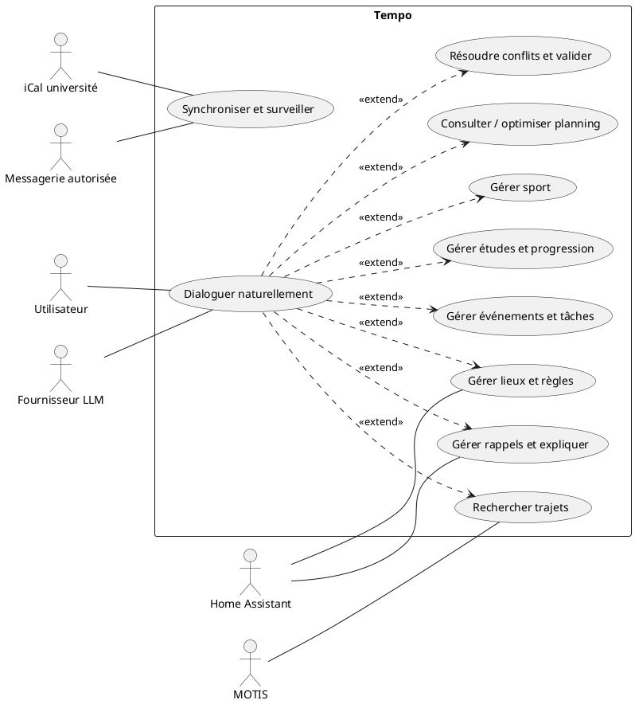

## 2. Règles métier non négociables

- Les cours universitaires (iCal) sont fixes ; iCal reste l'autorité sur ses événements.
- L'étude personnelle est déplaçable, y compris les séances acceptées, sauf verrouillage
  explicite. Les dates cibles sont **souples** par défaut, strictes seulement si l'utilisateur
  le dit.
- Les entraînements sont flexibles (jour et heure), leur contenu prescrit est conservé mot pour
  mot ; les compétitions sont fixes.
- La position réelle vient uniquement du `device_tracker` du téléphone configuré dans Home
  Assistant ; une intention future ne la remplace jamais. Pas de bascule automatique entre
  domiciles.
- Les trajets nécessaires sont obligatoires (marche, correspondances, marges, retours).
- Préférences d'étude (blocs de 90 min, alternance des matières, disponibilités) : souples,
  jamais plus fortes que la faisabilité.
- Les changements ordinaires d'activités flexibles sont automatiques ; une demande explicite
  autorise son périmètre ; les effets supplémentaires sur des engagements protégés (verrouillés,
  compétitions, engagements fixes) exigent un accord naturel.
- Jamais d'horaire, de durée, de lieu, de coordonnées, de trajet temps réel ou de résultat
  inventé. Un plan impossible ou partiel est annoncé comme tel.
- L'IA interprète ; le code déterministe vérifie les règles, OR-Tools planifie, MOTIS calcule
  les trajets. Le backend fonctionne sans LLM.
- Seuls les e-mails de l'expéditeur explicitement autorisé sont lus, jamais la boîte entière.
- Les contenus importés (iCal, e-mails, notes) sont des données, jamais des instructions.

## 3. Architecture logique

### D02 — Composants et dépendances

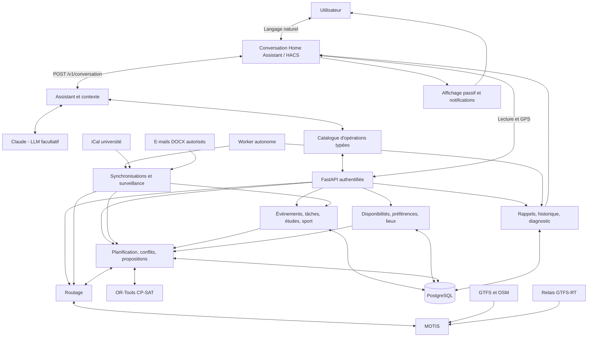

Backend monolithique modulaire (`backend/src/tempo`) + worker séparé. PostgreSQL est la source
de vérité ; Home Assistant n'est pas une seconde base de planning. MOTIS calcule les
itinéraires, OR-Tools résout les contraintes, Tempo orchestre. Aucune passerelle IA
supplémentaire.

| Module | Responsabilité |
|---|---|
| `assistant/catalog.py` | Catalogue des opérations (schéma Pydantic strict, résultat typé, `mutates`) ; **unique surface de mutation** pour l'IA et l'API (`/v1/operations`). |
| `assistant/agent.py` | Boucle d'appels d'outils Claude (Messages API, `claude-opus-5-5`, prompt système mis en cache, repli serveur `fallbacks`) ; bornée à 16 étapes. |
| `api/` | FastAPI : `/v1/conversation`, `/v1/operations`, lectures pour HA (`/v1/schedule`, `/v1/summary`, `/v1/tasks`, …), `/v1/location`, `/v1/interpret` (analyseur déterministe, repli sans LLM). |
| `domain/ops.py` | Règles partagées : journal de travail, séances de tâches, séries RRULE et exceptions. |
| `planning/` | Chargement des entrées, moteur (`engine.py`), publication versionnée (`service.py`), vues. |
| `scheduler/` | CP-SAT : étude (`solver.py`), activités flexibles (`activities.py`), validateur indépendant (`validate.py`). |
| `transport/` | Lieux, position, client MOTIS, trajets obligatoires, contrôle de départ, relais GTFS-RT, flux belges, STIB temps réel, mise à jour GTFS. |
| `sync/` | iCal (`ics.py`), programme du coach `.docx` (`coach_plan.py`, `coach_import.py`), IMAP restreint (`training_mail.py`). |
| `worker/` | Boucle de jobs durables (`job_run`) : iCal, séries, replanification, rappels, contrôle de départ, e-mails, rétention. |
| `../tempo-homeassistant` | Intégration HACS `custom_components/tempo` (dépôt séparé). |

## 4. Conversation et contrat d'opérations

### D03 — Séquence d'une demande composée

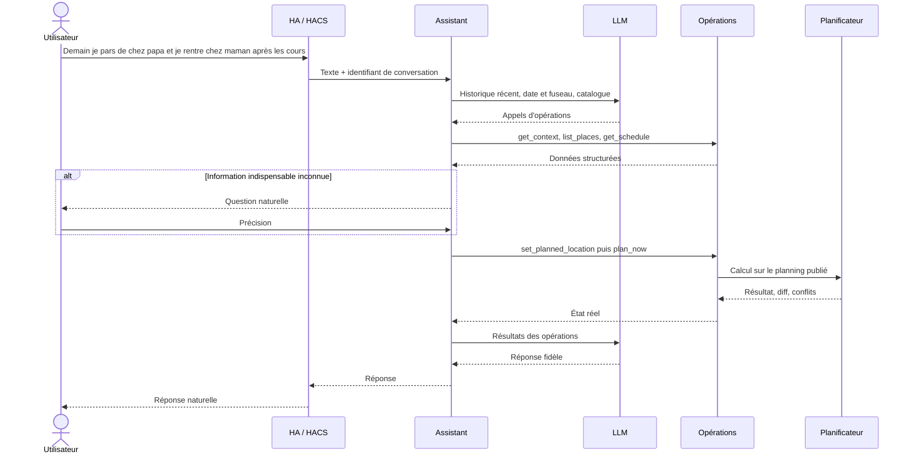

Contrat (implémenté) :
- Chaque opération valide ses arguments (Pydantic, `extra="forbid"`) avant exécution et
  s'exécute dans un point de sauvegarde : un échec ne laisse aucune écriture. Erreurs métier
  renvoyées comme résultat d'outil (`is_error`), jamais comme succès.
- Une mutation réussie est auditée (`audit_entry`, acteur `assistant`/`api`) et, si elle touche
  le planning, demande une replanification (`replan_requested`) ; l'assistant appelle
  `plan_now` pour obtenir le résultat réel.
- `POST /v1/operations/{name}` accepte un en-tête `Idempotency-Key` (réponse rejouée à
  l'identique). Le journal de travail est idempotent par clé.
- Contexte LLM : prompt système stable, 12 derniers tours de la conversation (6 h), date et
  fuseau Europe/Brussels dans le message ; données métier lues à la demande. Aucun accès SQL,
  shell, Docker ou secret.
- Sans LLM (pas de clé, panne, refus) : `/v1/conversation` répond via l'analyseur déterministe
  (`ai/text_parser.py`, `ai/questions.py`, `ai/actions.py`) et l'indique (`used_llm: false`).

| Domaine | Opérations |
|---|---|
| Lecture | `get_context`, `get_schedule`, `get_summary`, `list_activities`, `list_tasks`, `list_places`, `get_position`, `get_rules`, `list_proposals`, `list_notifications`, `list_reminders`, `explain_plan`, `get_sources_status`, `get_history` |
| Événements | `create_event` (fixe/flexible, journée entière occupée/informative, plusieurs jours, RRULE, distanciel), `update_event` (portée occurrence / suivantes / série), `cancel_event`, `set_lock`, `report_activity`, `confirm_activity` |
| Tâches et études | `create_task`, `update_task`, `log_work` (séance entière ou partielle, minutes, correction négative) |
| Lieux et règles | `upsert_place`, `delete_place`, `update_settings`, `set_weekly_availability`, `add_availability_exception`, `delete_availability_exception`, `set_planned_location`, `clear_planned_location` |
| Rappels et validation | `create_reminder`, `cancel_reminder`, `decide_proposal`, `acknowledge_notification` |
| Planning et transport | `plan_now` (local / global, simulation `dry_run`), `search_journey` |

## 5. Modèle métier

### D04 — Classes conceptuelles

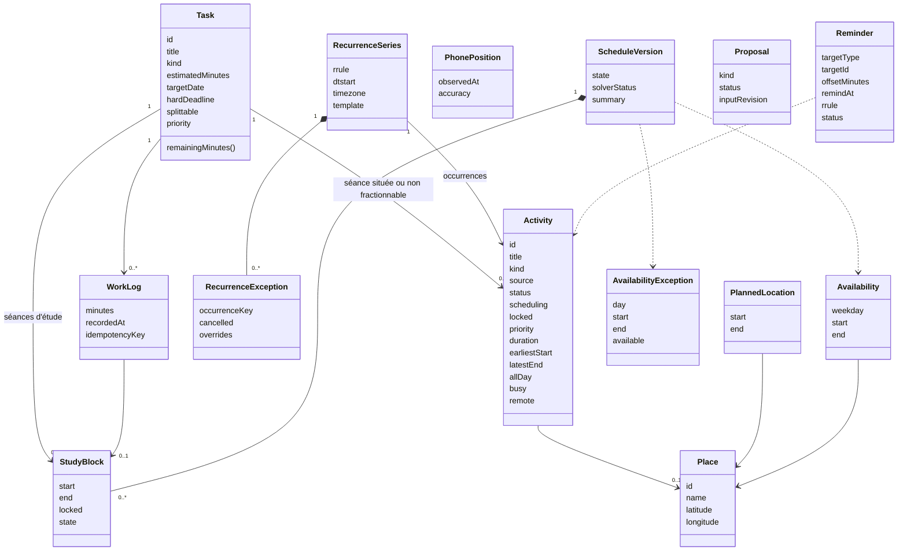

Correspondance avec PostgreSQL (`db/models.py`, migrations Alembic `0001`–`0005`) :
`activity` (catégories `personal`, `training`, `race`, `task` ; `scheduling` fixe/flexible ;
une compétition est toujours fixe par contrainte de base), `study_task` (tâches d'étude et
personnelles), `work_log`, `recurrence_series`, `recurrence_exception`, `study_block`,
`schedule_version`, `fixed_event` (iCal), `place`, `place_alias`, `phone_position`,
`availability_window`, `availability_exception`, `proposal`, `notification`, `reminder`,
`conversation_turn`, `audit_entry`, `job_run`, `sync_run`, `app_setting` (réglages, lieux
prévus `stays`, préférences).

Règles du modèle :
- Catégorie, mode (fixe/flexible) et verrouillage sont indépendants. Une activité fixe occupe
  `earliest_start_at..latest_end_at` ; une flexible se place dans cette fenêtre et son horaire
  (`planned_start_at`) appartient au plan.
- Événement journée entière : `busy` le fait bloquer ses jours, sinon il est seulement affiché.
  Une activité `remote` n'a pas de trajet.
- Une tâche n'est pas une séance : le reste dû = estimation − somme du `work_log`
  (`completed_minutes` n'est qu'un cache recalculé). Durée inconnue : tâche conservée, non
  planifiée. Sans échéance : planifiée comme cible lointaine souple. Une tâche située ou non
  fractionnable devient une seule activité flexible (`kind = task`).
- Séries : RRULE (python-dateutil) développée en heure locale du fuseau de la série (sûr au
  changement d'heure), matérialisée sur 60 jours glissants ; l'identité d'une occurrence est son
  heure locale d'origine. Une exception (déplacement, annulation) est conservée lors des
  réexpansions ; « cette occurrence et les suivantes » coupe la série (UNTIL) et en crée une
  nouvelle. Les lignes annulées restent pour l'historique.

### D05 — Cycle de vie d'une activité

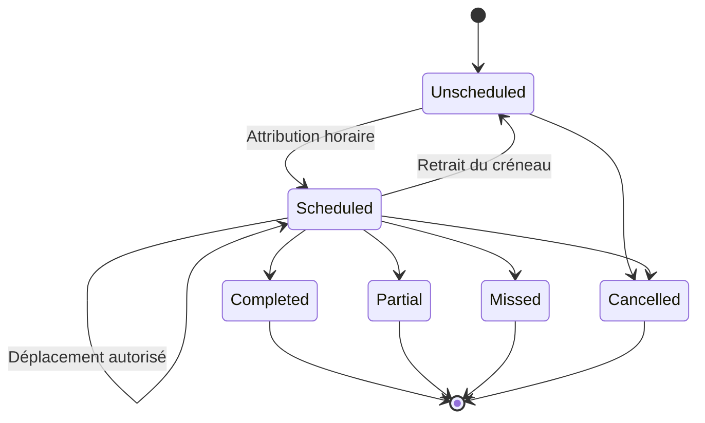

Statuts stockés : `active` (non placée si `planned_start_at` est nul), `to_confirm` (durée du
coach inconnue), `done`, `partial`, `missed`, `cancelled`. Un travail réalisé n'est jamais
déduit du passage de l'heure : une séance d'étude passée non déclarée devient `missed`, son
temps est replanifié, et l'utilisateur peut encore la déclarer faite.

## 6. Entrées par domaine

### D06 — Synchronisation des sources

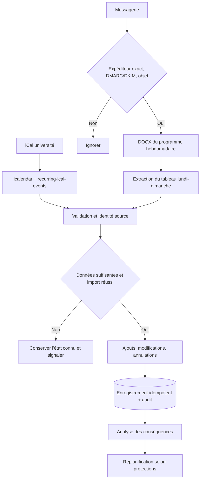

- **Université** (`sync/ics.py`, `db/ics_repository.py`) : identité (UID, RECURRENCE-ID UTC) ;
  suppression logique avec historique ; flux vide ou plus de 50 % de suppressions ⇒ sync
  `suspect`, suppressions retenues ; UID invalides jamais supprimés ; verrou consultatif par
  source ; heures inexistantes (passage à l'heure d'été) normalisées, ambiguës résolues sur la
  première occurrence, avec avertissement ; une série déplacée est appariée par UID et mise à
  jour en place. Une panne ou un import partiel n'est jamais une suppression générale.
- **Sport** (`sync/coach_plan.py`, `sync/coach_import.py`, `sync/training_mail.py`) : seul
  l'expéditeur exact configuré, authentifié DMARC/DKIM, est lu (filtre IMAP + revérification) ;
  boîte en lecture seule ; plan lu dans le `.docx` (colonnes lundi→dimanche, notation `1h15'`,
  `10'`, `30"`, `3x80m`). Jour suggéré = préférence souple ; contenu conservé ; durée absente ⇒
  `to_confirm` (jamais devinée) ; ordre et récupération de la semaine conservés (au plus 2 jours
  imposés) ; plan renvoyé ⇒ remplacement sans doublon, séances faites/verrouillées/modifiées par
  l'utilisateur jamais écrasées (proposition `coach_plan_change`) ; compétitions fixes avec
  approbation.
- **Études** : volume par tâche, cible souple par défaut ; une cible au-delà de l'horizon ne
  planifie que sa part proportionnelle ; journal de travail idempotent, corrections négatives.
- **Personnel** : rendez-vous fixes, sorties/activités flexibles dans une fenêtre ; durée
  inconnue ⇒ question, jamais de durée arbitraire.
- **Disponibilités** : fenêtres hebdomadaires par lieu + exceptions datées (temps bloqué ou
  temps libre supplémentaire à un lieu). Elles s'appliquent au travail flexible ; les
  engagements fixes restent prioritaires.

## 7. Localisation et transport

### D07 — Résolution de la localisation

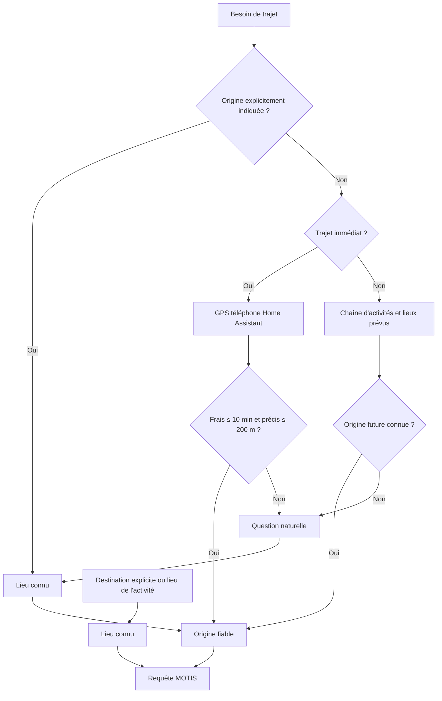

Chaque jour commence et finit à sa base (lieu prévu couvrant midi, sinon domicile). Deux
engagements séparés de plus de 3 h ⇒ retour à la base entre eux. Un texte de lieu iCal inconnu
bloque le temps sans trajet et est signalé (ajouter un alias). Coordonnées jamais devinées.

### D08 — Données et moteur de transport

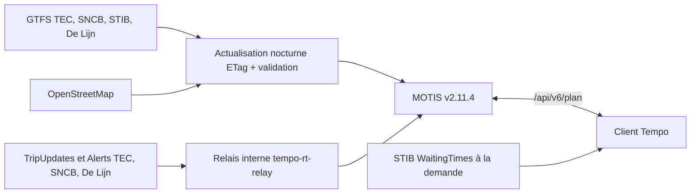

Faits vérifiés le 23/11/2026 par requêtes réelles :
- Belgian Mobility Open Data : 4 GTFS statiques + TripUpdates et Alerts pour TEC, SNCB et
  De Lijn, hôte `api-management-discovery-production.azure-api.net/api/gtfs/feed/<op>/...`
  (`?format=protobuf` obligatoire pour le temps réel). L'hôte documenté
  `opendata-discovery-gtfs-realtime...` n'avait pas d'enregistrement DNS. STIB : statique
  seulement en GTFS ; temps réel STIB via `api/datasets/stibmivb/rt/WaitingTimes` (à la
  demande, cache 15 min, plafonné).
- Quotas indicatifs : anonyme 100/jour ; clé Standard (en-tête `bmc-partner-key`) 12 000/jour.
  Acceptation de la clé sur cet hôte **non vérifiée** (pas de clé).
- Relais (`transport/rt_relay.py`, une seule réplique) : détient la clé, plafonne à 80 % du
  quota, recul exponentiel, `Retry-After` respecté, répond 503 au-delà de 10 min de fraîcheur
  (MOTIS abandonne alors ce temps réel : vérifié), retire `start_time` des TEC (décalage de
  12 h en amont ; résolution 50 % → 100 %).
- Alertes : consultatives, filtrées par période d'impact, jamais d'exclusion de trajet ;
  annulations et retards viennent des TripUpdates. Un retard réel de +7 min a été observé.
- MOTIS national : import 3 min 29 s, 1,8 Go, serveur 0,7–0,9 Go, requête médiane 100–130 ms.

Contrat de recherche (`search_journey`) : origine (lieu connu ou GPS fiable), destination, au
moins une borne (arrivée avant, départ après, ou les deux = plage), objectif (durée minimale
par défaut, arrivée au plus tôt, départ au plus tard), départage déterministe. Statuts : `ok`
(meilleur + alternatives, « meilleur parmi les candidats explorés »), `no_candidate`,
`origin_unknown`, `unavailable`, `error` (panne, jamais présentée comme impossibilité).
Trajets du planning : aller avec marge (10 min par défaut) avant l'engagement, retour sans
marge ; dernier départ réalisable puis moins de correspondances ; aucun trajet ⇒
`impossible` ; panne ⇒ `unknown` ; le créneau reste bloqué et le problème est signalé.

## 8. Planification, stabilité et absence de solution

### D10 — Replanification

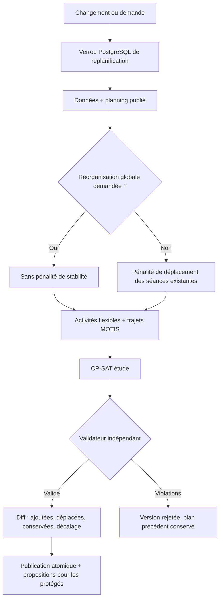

- Pipeline (`planning/engine.py`) : engagements fixes (cours, compétitions, activités fixes ou
  verrouillées) → activités flexibles placées dans leur fenêtre avec trajets réservés
  (`scheduler/activities.py`) → trajets obligatoires jour par jour → fenêtres d'étude réduites
  par les trajets → CP-SAT d'étude → validation indépendante.
- Contraintes dures : pas de chevauchement, horaires imposés, verrouillages, disponibilités,
  durées prescrites, échéances strictes, ordre et récupération des séances du coach, trajets.
  Jamais relâchées silencieusement.
- Objectif (pondérations bornées, `scheduler/solver.py`) : travail non planifié (poids
  dominant, multiplié par la priorité 1–3) ≫ retard sur cible souple > stabilité (déplacer une
  séance existante coûte 200) > alternance des matières > longueur préférée de 90 min >
  dépassement. Seconde passe : seules les tâches incomplètes peuvent dépasser le nombre de
  blocs par matière et par jour. Une solution équivalente sans déplacement est donc préférée.
- Mode `global` uniquement sur demande explicite (`plan_now(mode="global")`) : la stabilité est
  ignorée ; verrouillé et en cours restent protégés. `dry_run` simule sans publier.
- Concurrence : `pg_advisory_xact_lock` sérialise API et worker ; une seule version `active`.
- Performance : borne inférieure prouvée + démarrage glouton ; 8 semaines / 8 matières en
  ~1 s (prouvé optimal) sur le poste de développement.

### D11 — Diagnostic des résultats

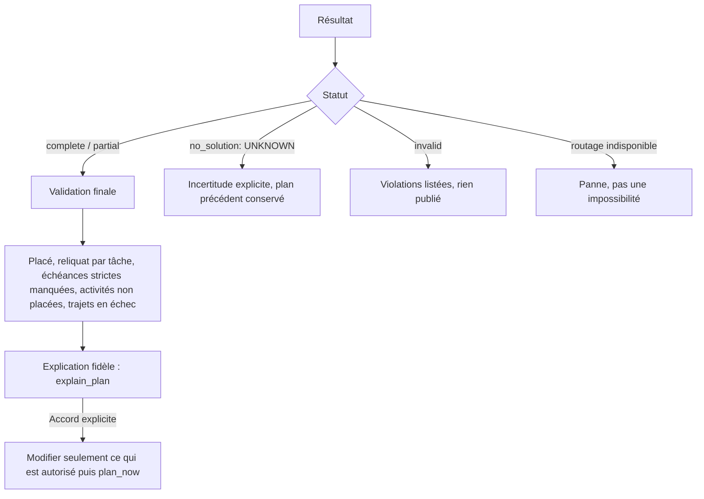

Exemple vérifié par test : « 50 h de chimie avant demain, stricte » ⇒ statut `partial`,
minutes non planifiées par tâche, échéance stricte signalée comme manquée, jamais comme
réussie. Les alternatives (élargir une disponibilité, reporter une échéance, …) sont simulées
par l'assistant via `dry_run` puis proposées à l'utilisateur.

## 9. Validation, propositions et concurrence

### D14 — États d'une proposition

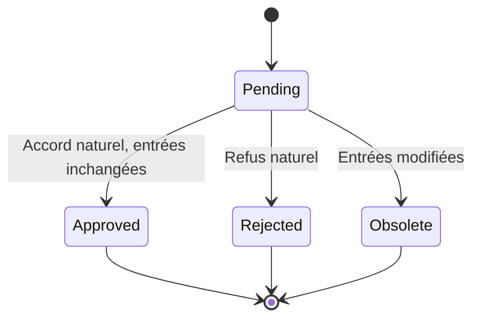

- Une proposition (`unlock_block`, `unlock_activity`, `coach_plan_change`, `training_import`)
  enregistre l'empreinte de son entrée (`input_revision`) ; à l'accord, l'empreinte est
  recalculée : différente ⇒ `obsolete`, rien n'est appliqué, une replanification est demandée.
- Modification iCal nocturne : le cours officiel est enregistré immédiatement ; l'étude
  flexible est réoptimisée automatiquement (changement ordinaire) ; un engagement protégé en
  conflit (séance verrouillée, entraînement verrouillé) produit une proposition ; une
  compétition ou un rendez-vous fixe en conflit produit une notification de conflit (rien ne
  bouge). Les rappels relatifs suivent le planning publié, jamais une proposition.
- Accord et refus se font en conversation (`decide_proposal` sur une proposition identifiée ;
  repli déterministe « accepte » / « refuse » s'il n'y en a qu'une).

## 10. Worker, rappels et notifications

### D15 — Cycle autonome

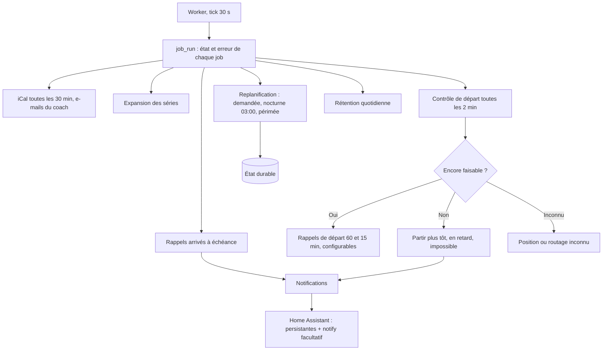

- Rappels utilisateur (`reminder`) : à heure fixe (éventuellement RRULE) ou N minutes avant une
  activité ou un cours ; l'échéance est recalculée depuis la cible à chaque contrôle (un
  déplacement déplace le rappel, une annulation l'annule). Identité = rappel + instant dû :
  pas de doublon après redémarrage ; un rappel manqué pendant une panne part au redémarrage
  (jusqu'à 6 h, marqué « en retard »).
- Rappels de départ : plusieurs seuils (`update_settings.departure_reminder_minutes`), sur le
  prochain trajet aller, recalculés avec la position réelle et le temps réel.
- L'absence de temps réel n'est pas une confirmation de ponctualité (legs « horaire théorique »).
- Notifications dédupliquées par clé ; informatives uniquement (aucune action dans la
  notification).
- Aucun job ne dépend du LLM ; l'import d'e-mails par LLM (texte libre) passe par une
  proposition à approuver.

## 11. Déploiement et exigences non fonctionnelles

### D16 — Déploiement cible

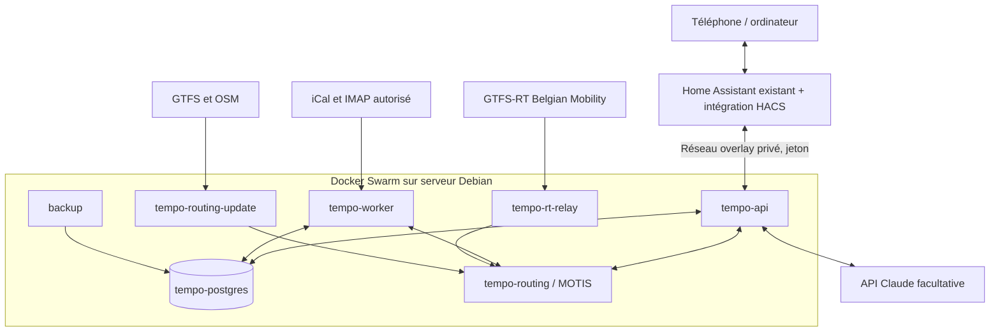

- Réseaux : `backend` et `routing` internes ; `ha` partagé avec Home Assistant ; `egress` pour
  le worker (iCal, IMAP), le relais, la mise à jour des données et l'API (LLM seulement).
  PostgreSQL et le relais ne sont jamais publiés.
- Sécurité : jeton de service fort (≥ 16 caractères distincts), rotation avec un jeton précédent,
  comparaison à temps constant, blocage après 10 échecs/60 s (429), `/health` seul public,
  OpenAPI désactivé côté HTTP ; secrets Docker (`/run/secrets`) ; images non root, système de
  fichiers en lecture seule, dépendances épinglées ; deux rôles PostgreSQL (propriétaire DDL,
  rôle applicatif DML, audit en ajout seul) ; logs sans jeton ni données personnelles.
- Fiabilité : migrations Alembic sérialisées par verrou consultatif ; transactions et points de
  sauvegarde ; versions de planning ; sauvegarde quotidienne + exercice de restauration ;
  health checks ; retries bornés ; calculs en UTC, règles en heure locale (sûr aux changements
  d'heure).
- Performance : horizon glissant (14 jours par défaut, cibles lointaines conservées en part
  proportionnelle), séries matérialisées sur 60 jours, solveur limité à 10 s.
- Pas de dépendance à Claude Code en production.

## 12. État réel et recette

Légende : **Vérifié** = test automatisé sur PostgreSQL réel (et MOTIS réel quand indiqué) ;
**Partiel** = implémenté, une partie de la vérification manque ; **Non** = non fait.

| Besoin | État | Preuve / écart |
|---|---|---|
| B01 Conversation | Partiel | Agent Claude à outils + repli déterministe testés avec un client LLM simulé (`tests/integration/test_assistant.py`) et test de contrat HA ↔ backend. **Jamais exécuté avec un vrai LLM** (aucune clé) ni dans un Home Assistant réel. |
| B02 Événements | Vérifié | Fixe, flexible, journée entière occupée/informative, plusieurs jours, série + exception + « suivantes » + série entière, verrouillage (`test_operations.py`). |
| B03 Tâches | Vérifié | Sans durée puis estimée, planifiée, progression partielle idempotente, séance unique située. |
| B04 Université | Partiel | Import, modifications, annulations, sync suspecte, DST testés sur fixtures. **Flux iCal réel de l'université non testé** (URL non fournie). |
| B05 Études | Vérifié | 15 h, blocs de 90 min, souple/stricte, correction sans double comptage. |
| B06 Sport | Partiel | DOCX, mise à jour sans doublon, durée inconnue, protections testés (fixtures + vrai serveur IMAP local). **Adresse réelle du coach et boîte réelle non configurées.** |
| B07 Règles | Partiel | Fenêtres hebdomadaires + exceptions datées + préférences. **Écart** : pas de fenêtres par catégorie d'activité (les fenêtres s'appliquent au travail d'étude/tâches). |
| B08 Lieux | Vérifié | GPS frais/périmé/imprécis, lieu prévu sans altérer le GPS, origine inconnue ⇒ question. |
| B09 Transport | Partiel | `search_journey` vérifié sur un **vrai MOTIS** (région de Bruxelles) : arrivée avant, départ après, plage, aucun candidat (`test_motis_live.py`) ; panne et origine inconnue testées avec MOTIS simulé ; client MOTIS vérifié aussi sur le graphe national. **Écart** : une seule requête par recherche (pas de pagination MOTIS `nextPageCursor`), donc « meilleur parmi les candidats explorés ». |
| B10 Planning mixte | Vérifié | Cours, étude, entraînements, compétition, activités personnelles, trajets ; validateur indépendant. |
| B11 Stabilité | Vérifié | Ajout en créneau libre sans déplacement ; conflit local avec changements minimaux ; mode global sur demande. Poids bornés, pas d'optimisation lexicographique stricte. |
| B12 Conflits | Partiel | Manque de temps, reliquat, échéance stricte manquée, panne de routage, version invalide rejetée. **Écart** : les alternatives ne sont pas générées automatiquement (l'assistant simule avec `dry_run`) ; pas de calcul de noyau incompatible. |
| B13 Validation | Vérifié | Proposition périmée rejetée ; replanifications concurrentes sérialisées (3 fils). |
| B14 Notifications | Vérifié | Rappel relatif qui suit sa cible, sans doublon, annulé avec la cible ; plusieurs rappels de départ. |
| B15 Autonomie | Partiel | Jobs testés individuellement, sans LLM. **Fonctionnement prolongé (soak) non mesuré.** |
| B16 Explication | Vérifié | `explain_plan`, `get_sources_status`, `get_history`. |
| B17 Fiabilité | Partiel | PostgreSQL 16 réel, migrations montantes/descendantes, rôles, authentification. **Non fait** : installation HACS réelle (dépôt non publié), déploiement Swarm (non autorisé), exercice de restauration sur le serveur. |

Dernière exécution locale (24/11/2026) : backend 483 tests réussis (PostgreSQL 16 réel, MOTIS
Bruxelles réel, contrat avec le vrai client HA), 13 ignorés avec leur raison (MOTIS national,
portail Belgian Mobility et IMAP réel non lancés dans cette session), couverture 91 %, Ruff et
mypy strict propres ; intégration HA 63 tests réussis (HA 2026.2.3), mypy strict et Ruff propres.

Bloquants nécessitant l'utilisateur : clé API Claude (tester B01 réellement), URL iCal de
l'université, entité `device_tracker`, adresse de l'expéditeur du coach + accès IMAP, clé
Belgian Mobility Standard, création et visibilité des dépôts GitHub, licence de l'intégration,
autorisation de déploiement Swarm.

## 13. Décisions techniques conservées

- Deux dépôts : ce dépôt privé (backend, worker, base, routage, déploiement) et
  `tempo-homeassistant` (HACS exige `custom_components/<domaine>/` à la racine d'un dépôt
  public). Aucun des deux n'est publié sans accord.
- Python 3.13 + `uv` (verrou `backend/uv.lock`), Ruff, mypy `--strict`, pytest ; `tzdata`
  explicite ; client HTTP `httpx2` ; SDK `anthropic` (modèle `claude-opus-5-5`).
- iCal : `icalendar` + `recurring-ical-events`, avec pré-analyse de la source car la
  bibliothèque ajoute un RECURRENCE-ID aux événements non récurrents et inverse silencieusement
  DTSTART/DTEND incohérents.
- Tests d'intégration PostgreSQL locaux via `pgserver` (PostgreSQL 16) ; PostgreSQL ≥ 15 requis
  (`NULLS NOT DISTINCT`).
- Image de routage : binaire officiel MOTIS v2.11.4 épinglé par SHA-256 ; reconstruction des
  graphes dans un volume séparé avec bascule atomique et conservation de la version précédente.
- Les e-mails libres interprétés par LLM ne sont jamais appliqués sans approbation.
- Les routes REST de mutation historiques (`/v1/tasks` POST/PATCH, `/v1/places`, `/v1/blocks`,
  `/v1/activities`, `/v1/proposals/{id}/approve|reject`, `/v1/replan`) restent comme
  implémentation interne des opérations correspondantes ; l'intégration HA ne les appelle plus.
