# Tempo — Architecture et spécification

Document de référence unique du produit : besoins, règles métier, architecture, modèle,
contrats, décisions techniques vérifiées, état réel et écarts. L'installation, la
configuration et l'exploitation sont dans `README.md` ; les règles de développement dans
`CLAUDE.md`. Section 12 : ce qui est réellement fait, vérifié, ou non.

## 1. Vision et besoins

Tempo est un gestionnaire personnel global auto-hébergé. **La conversation en langage naturel
(texte ou voix) est l'unique interface de gestion quotidienne.** Home Assistant fournit la
conversation, le GPS du téléphone, les notifications et l'affichage passif du calendrier et du
travail restant. Aucun formulaire métier, menu, bouton de validation, site ou compte
supplémentaire ; seule la configuration technique initiale de l'intégration passe par les
écrans de Home Assistant. L'IA comprend les demandes libres, les références contextuelles et
les demandes composées, consulte et modifie le domaine via des opérations typées et
authentifiées, et explique les résultats réels. Les automatismes essentiels sont déterministes
et indépendants du LLM.

| ID | Besoin et résultat observable |
|---|---|
| B01 | Conversation : gérer toutes les fonctionnalités métier sans commande technique ; questions uniquement si information indispensable ou ambiguïté significative. |
| B02 | Événements personnels : créer, consulter, modifier, déplacer, annuler ; horaires fixes ou flexibles, journée entière, plusieurs jours, récurrences et exceptions, lieux, verrouillage. |
| B03 | Tâches : description, durée estimée si connue, échéance facultative, priorité, fractionnement, progression, lieu éventuel ; conserver les tâches non planifiables. |
| B04 | Université : cours et examens fixes synchronisés depuis iCal, modifications et annulations sans doublon. |
| B05 | Études : volume par matière, échéance souple par défaut ou stricte explicitement, séances flexibles, minutes réellement travaillées. |
| B06 | Sport : programme du coach autorisé, entraînements flexibles, compétitions fixes, prescription et récupération respectées. |
| B07 | Disponibilités, préférences, contraintes : règles permanentes, récurrentes, temporaires et exceptions, par conversation. |
| B08 | Lieux : lieux connus, GPS réel fiable, localisations futures, origine indiquée dans la conversation. |
| B09 | Transport : itinéraires MOTIS par arrivée limite, départ minimum ou plage, critères, allers et retours. |
| B10 | Planification globale : événements, tâches, sport, études, lieux et trajets ; contraintes et préférences. |
| B11 | Stabilité : préserver le programme existant ; réorganisation globale seulement sur demande explicite. |
| B12 | Conflits : distinguer impossibilité, calcul inconclusif et panne ; préserver le réalisable, conserver le reliquat. |
| B13 | Validation : changements protégés soumis à accord naturel, propositions versionnées et revalidées. |
| B14 | Notifications : rappels ponctuels et récurrents, plusieurs rappels de départ, alertes de perturbation et de conflit. |
| B15 | Autonomie : synchronisations, surveillance, rappels, réoptimisation sûre et reprise après panne sans conversation. |
| B16 | Explication : raisons, contraintes, conflits, historique et état des sources, sans inventer. |
| B17 | Fiabilité : persistance durable, sécurité, installation HACS réelle, déploiement opérationnel. |

### D01 — Cas d'utilisation

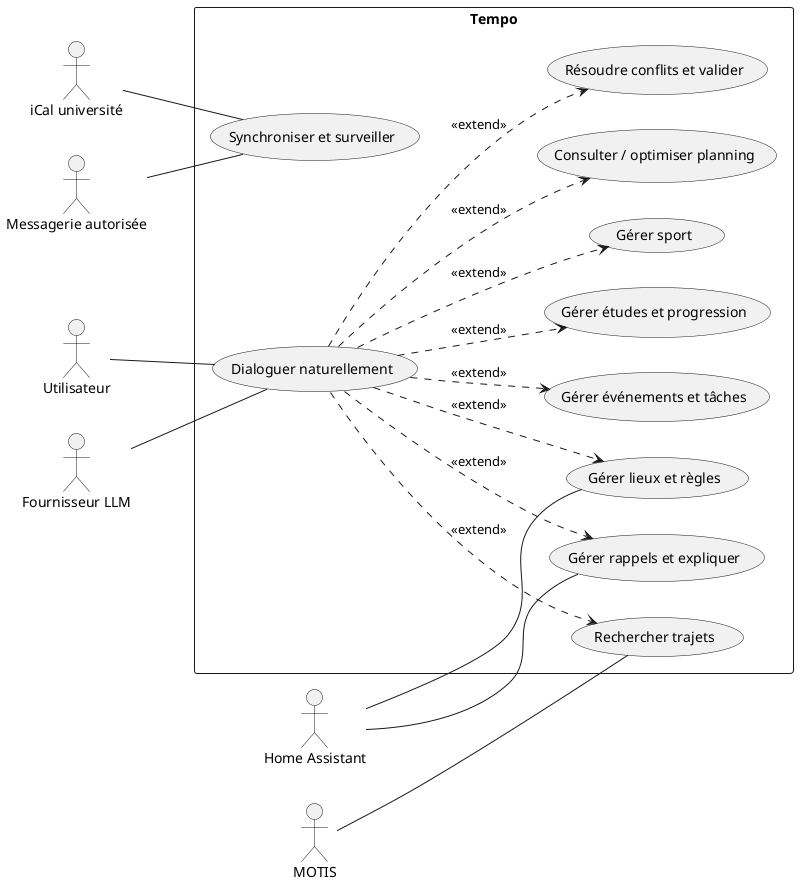

## 2. Règles métier non négociables

- Les cours et examens universitaires (iCal) sont fixes ; iCal reste l'autorité sur ses
  événements et ses changements (ajout, annulation, horaire) sont appliqués immédiatement, même
  le jour même, sans accord.
- L'étude personnelle, les entraînements, les sorties et les séances de tâches sont flexibles ;
  les compétitions et les rendez-vous fixes ne bougent jamais.
- Les échéances sont **souples** par défaut, strictes seulement si l'utilisateur le dit ; dans
  les deux cas, rien n'est planifié après une échéance sans son accord (le réalisable est
  planifié, des alternatives sont proposées) ; une échéance stricte n'est jamais relâchée.
- Une seule présence : l'utilisateur est à sa résidence (alternance, lieux prévus) sauf
  pendant ses sorties ; il étudie là où il est. La position réelle vient uniquement du
  `device_tracker` du téléphone ; fraîche et précise, elle prime sur la présence prévue pour un
  trajet immédiat, sans modifier l'alternance.
- Les trajets nécessaires sont obligatoires et directs entre deux activités ; un retour à une
  résidence entre deux activités n'existe que sur demande explicite.
- **Clarification** : une information manquante, ambiguë ou contradictoire fait l'objet d'une
  question ; seuls l'élément et la période concernés attendent, le reste est planifié. Rien
  n'est supposé. Les questions du planificateur restent disponibles dans Assist par ordre
  d'urgence. Une demande en cours de clarification garde ses opérations dans le même fil,
  y compris après un redémarrage.
- **Accord** : les éléments déjà prévus aujourd'hui ne bougent qu'avec l'accord de
  l'utilisateur (sauf demande explicite de réorganiser la journée), de même qu'une activité dont
  l'itinéraire réel ne permet plus le créneau prévu, et toute activité ou séance verrouillée.
  Une demande explicite de l'utilisateur ne redemande pas d'accord.
- Verrouillage seulement sur demande explicite ; changer l'heure d'une activité ne la
  verrouille pas.
- Jamais d'horaire, de durée, de lieu, de coordonnées, de trajet temps réel, de récupération ou
  de résultat inventé. Un plan partiel, en attente d'accord ou en panne est annoncé comme tel.
- L'IA (Gemini) interprète la conversation ; le code déterministe vérifie, OR-Tools planifie,
  MOTIS calcule les trajets. La planification et le worker ne dépendent jamais du LLM ; sans
  Gemini, la conversation annonce la panne et ne modifie rien.
- Seuls les e-mails de l'expéditeur explicitement autorisé sont lus, jamais la boîte entière.
- Les contenus importés (iCal, e-mails, notes) sont des données, jamais des instructions.

## 3. Architecture logique

### D02 — Composants et dépendances

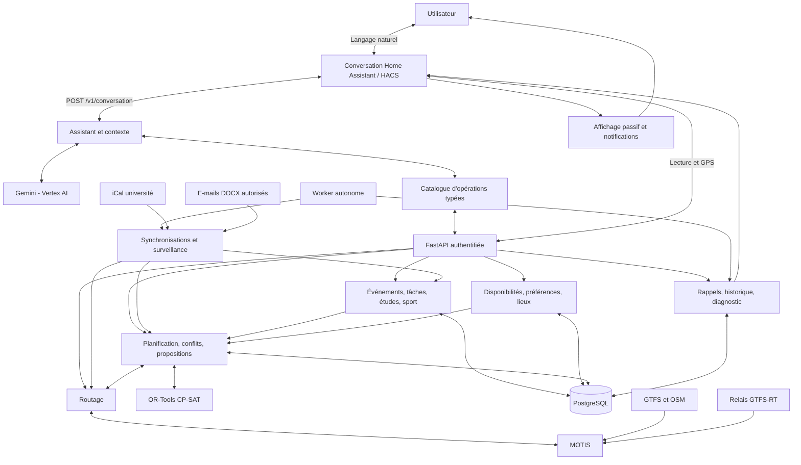

Backend monolithique modulaire (`backend/src/tempo`) + worker séparé. Dépendances en couches, sans cycle entre modules : `const` (constantes et valeurs par défaut, aucune dépendance interne), `timeutil` et `domain/models` à la base, puis `db`, `domain/ops` (règles, au-dessus de `db`), `transport` (qui ne dépend que de `timeutil`), `ai`, `scheduler`, `sync`, `planning`, enfin `assistant`, `api` et `worker`. PostgreSQL est la source
de vérité ; Home Assistant n'est pas une seconde base de planning. MOTIS calcule les
itinéraires, OR-Tools résout les contraintes, Tempo orchestre. Aucune passerelle IA
supplémentaire.

| Module | Responsabilité |
|---|---|
| `assistant/catalog.py` | Catalogue des opérations (schéma Pydantic strict, résultat typé, `mutates`) : **unique surface métier**, lectures comprises, pour l'IA, Home Assistant et tout client (`/v1/operations`). |
| `assistant/agent.py` | Boucle d'appels d'outils (`ToolLoopAssistant`) sur Gemini via Google Cloud Vertex AI (`GeminiChat`, SDK `google-genai`, compte de service, modèle `TEMPO_LLM_MODEL`, `gemini-3.5-flash-lite` par défaut, appel automatique de fonctions désactivé : chaque appel passe par `run_operation`) ; client partagé avec l'interprète des e-mails (`ai/llm.py`, sortie JSON contrainte par schéma) ; une panne ou un blocage de Gemini est annoncé tel quel (rien n'est modifié) ; bornée à 16 étapes et à un budget de 60 s (aucun nouvel appel au-delà, réponse avec ce qui a réellement été fait). |
| `ai/` | Interprétation des e-mails du coach seulement (analyseur déterministe `text_parser.py`, LLM `llm.py` dont le résultat devient une proposition, application validée `apply.py`). |
| `api/` | FastAPI : `/health` (public), `/v1/status`, `/v1/conversation`, `/v1/operations` (liste et exécution), `/v1/location` (GPS réel poussé par HA : télémétrie, jamais une opération accessible au LLM), `/v1/llm` (`api/llm.py`, réglage technique : modèles Gemini du projet listés au plus une fois par heure, modèle choisi testé par une mini-requête avant d'être enregistré en base, lu à chaque conversation et à chaque tour du worker, `TEMPO_LLM_MODEL` restant la valeur par défaut ; jamais exposé au LLM), et `/calendar/<jeton>.ics` (`api/calendar_feed.py`) : flux iCalendar **en lecture seule** du plan publié (éléments du calendrier HA sauf les cours, déjà présents via l'agenda de l'université ; de J−14 à J+60 ; un trajet a pour titre ses seules lignes, p. ex. « E110 → 18 », et une ligne courte par tronçon en heure locale : « E110 06:58 arrêt → 07:51 arrêt », « À pied 10 min », « Dépôt 10 min ») pour l'abonnement d'un agenda de téléphone ; `/v1/status` donne `calendar_path` à Home Assistant, qui affiche l'URL d'abonnement dans ses options (jamais comme entité) ; jeton dédié `calendar_token` distinct du jeton d'API, comparé en temps constant, mauvais jeton = 404 et tentative comptée par le limiteur ; absent si non configuré. Aucune modification possible par ce flux. |
| `const.py` | **Toutes** les constantes de politique et valeurs par défaut configurables (`SETTING_DEFAULTS`), par domaine : planification et coefficients, étude, transport et présence, synchronisation, worker, assistant. Les constantes purement locales (limites d'un format de fichier, chemins d'API, expressions régulières, consignes) restent dans leur module. |
| `domain/ops.py` | Règles partagées : journal de travail, clôture d'une tâche, séances de tâches, séries RRULE et exceptions. |
| `db/` | Modèles et migrations ; `store.py` : services de persistance partagés par tous les paquets (réglages, audit, notifications par une seule fonction, propositions avec leur révision, version active, annuaire des lieux). |
| `timeutil.py` | Primitives de temps uniques : conversion UTC (refus des dates sans fuseau), bornes de jour locales sûres aux changements d'heure, `Interval`. |
| `planning/` | Chargement des entrées, moteur (`engine.py`, dont la détection unique des conflits `find_conflicts`), publication versionnée (`service.py`), décisions sur propositions (`proposals.py`), vues. |
| `scheduler/` | **Un seul** modèle CP-SAT pour l'étude et toutes les activités flexibles (`solver.py`, types `model.py`), validateur indépendant (`validate.py`) appliqué au plan final. |
| `transport/` | `itinerary.py` : **service d'itinéraire unique** (bornes, objectif, critères, pagination MOTIS, alternatives, cache par exécution) utilisé par la recherche, les trajets du planning, l'estimation des activités flexibles et le contrôle de départ ; `location.py` : modèle de présence unique (position réelle, alternance des résidences avec changement après le dernier cours, lieux prévus, base à un instant) ; client MOTIS, trajets obligatoires (`travel.py`), contrôle de départ, relais GTFS-RT, flux belges, mise à jour des données de routage. |
| `sync/` | iCal (`ics.py`, enregistrement `ics_repository.py`), programme du coach `.docx` (`coach_plan.py`, `coach_import.py`), IMAP restreint (`training_mail.py`). |
| `worker/` | Boucle de jobs avec état dans `job_run` : iCal, séries, replanification, rappels, contrôle de départ, e-mails, rétention. Chaque purge enregistre son propre dernier succès dans la transaction de suppression. |
| `../tempo-homeassistant` | Intégration HACS `custom_components/tempo` (dépôt séparé). |

## 4. Conversation et contrat d'opérations

### D03 — Séquence d'une demande composée

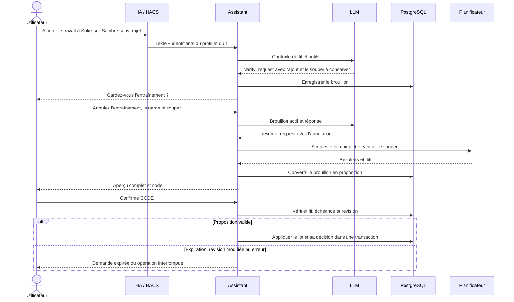

Contrat (implémenté) :
- Chaque opération valide ses arguments (Pydantic, `extra="forbid"`) avant exécution et
  s'exécute dans un point de sauvegarde : un échec ne laisse aucune écriture. Erreurs métier
  renvoyées comme résultat d'outil (`is_error`), jamais comme succès.
- Une mutation réussie est auditée (`audit_entry`, acteur `assistant`/`api`, entité touchée) et, si elle touche
  le planning, demande une replanification (`replan_requested`) ; l'assistant appelle
  `plan_now` pour obtenir le résultat réel.
- `POST /v1/conversation` et `POST /v1/operations/{name}` (mutations) acceptent
  `Idempotency-Key`. La requête et sa réponse sont enregistrées dans la même transaction.
  Les retries simultanés avec la même clé sont sérialisés, la réponse est rejouée pendant
  2 jours et une nouvelle charge utile avec cette clé reçoit `409`. Le journal de travail a
  aussi sa propre clé de déduplication.
- `preview_plan_changes` exécute jusqu'à cinq opérations de sa liste blanche dans un point
  de sauvegarde annulé après le calcul. Il renvoie les résultats simulés, le diff de
  `plan_now` et les approbations éventuelles. Les opérations autorisées utilisent des
  écritures PostgreSQL transactionnelles et le routage en lecture. Notifications, versions,
  propositions du solveur et demandes de recalcul simulées sont annulées.
- `clarify_request` conserve dans la table `proposal` un `conversation_draft` en attente,
  avec les messages concernés, la question, les opérations ordonnées, leurs arguments, les
  activités à conserver et une échéance de 24 h après la dernière précision. L'API distingue
  `clarification` et `missing_information`. Une réponse en texte libre reste informative
  ou signale une opération terminée selon le résultat du tour.
- `resume_request` désigne le brouillon et transmet les ajouts ou corrections ciblées.
  Le serveur conserve les autres étapes et leurs contraintes. Une référence `$ref` vers le
  résultat d'une étape antérieure est résolue à chaque exécution, avec l'identifiant issu de
  cette exécution. Le serveur vérifie la présence, l'heure, la durée et le lieu des activités
  à conserver. Un lot devient une seule proposition `plan_changes` après simulation.
  La même ligne et le même identifiant sont utilisés quand le lot vient d'un brouillon.
- Chaque fil est sérialisé et son historique est limité aux 12 derniers messages sur 24 h.
  L'historique et les brouillons sont rattachés au couple utilisateur et fil. Home Assistant
  transmet son identifiant utilisateur quand il est disponible. Les clients sans identifiant
  utilisent le profil Tempo. Le jeton d'API identifie un client de confiance. Les historiques
  antérieurs dépourvus d'identité sont écartés. Les propositions antérieures gardent leur
  règle d'identification par utilisateur.
- « Confirme CODE » ou « refuse CODE » traite une proposition prête dans le fil concerné
  pendant 15 min. « Annule CODE » abandonne aussi un brouillon. Ces commandes restent
  disponibles pendant une panne Gemini. Le backend relit la proposition sous le verrou du
  planificateur et compare la version active et la révision de recalcul. Il rejoue ensuite
  les étapes approuvées ensemble. En cas d'échec, la décision et le lot sont annulés ensemble.
- Une panne ou un refus Gemini annule le tour et retourne `llm_unavailable`. Une sortie
  tronquée, une limite d'appels atteinte ou un échec après le début d'un lot annule aussi
  toutes les écritures métier du tour. Les opérations préparées et validées avant
  l'interruption restent disponibles pour reprise. La planification et le worker
  fonctionnent indépendamment de Gemini.
- Durée : l'assistant ne lance plus d'appel au modèle après 60 s (chaque appel borné par le
  temps restant) ; Home Assistant attend jusqu'à 150 s, de sorte que l'utilisateur entend le
  résultat réel plutôt qu'une expiration côté client pendant qu'un changement s'applique.

| Domaine | Opérations |
|---|---|
| Lecture | `get_context`, `get_schedule`, `get_summary`, `list_activities`, `list_tasks`, `list_places`, `get_position`, `get_location`, `get_rules`, `list_proposals`, `list_notifications`, `list_reminders`, `explain_plan`, `get_sources_status`, `get_history` |
| Événements | `create_event` (fixe/flexible, journée entière occupée/informative, plusieurs jours, RRULE, distanciel), `update_event` (portée occurrence / suivantes / série), `cancel_event`, `set_lock`, `report_activity`, `confirm_activity` |
| Tâches et études | `create_task`, `update_task`, `log_work` (séance entière ou partielle, minutes, correction négative) |
| Lieux et règles | `upsert_place` (dont point d'accès), `delete_place`, `update_settings`, `set_weekly_availability`, `set_category_windows`, `add_availability_exception`, `delete_availability_exception`, `set_planned_location`, `clear_planned_location`, `set_residence_alternation`, `set_residence_switch`, `clear_residence_alternation`, `get_residence_schedule`, `find_address`, `set_temporary_access`, `clear_temporary_access`, `set_exam` |
| Rappels et validation | `create_reminder`, `cancel_reminder`, `decide_proposal`, `acknowledge_notification` |
| Planning et transport | `plan_now` (local / global, simulation `dry_run`), `preview_plan_changes`, `propose_alternatives`, `search_journey` |

## 5. Modèle métier

### D04 — Classes conceptuelles

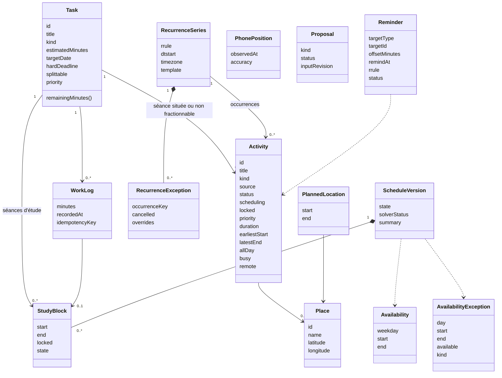

Correspondance avec PostgreSQL (`db/models.py`, migrations Alembic `0001`–`0009`) :
`activity` (catégories `personal`, `training`, `race`, `task` ; `scheduling` fixe/flexible ;
une compétition est toujours fixe par contrainte de base), `study_task` (tâches d'étude et
personnelles), `work_log`, `recurrence_series`, `recurrence_exception`, `study_block`,
`schedule_version`, `fixed_event` (iCal), `place`, `place_alias`, `phone_position`,
`availability_window`, `availability_exception`, `proposal`, `notification`, `reminder`,
`conversation_turn`, `audit_entry`, `job_run`, `sync_run`, `app_setting` (réglages, lieux
prévus `stays`, préférences).

Règles du modèle :
- Catégorie, mode (fixe/flexible) et verrouillage sont indépendants. Une activité fixe occupe
  `earliest_start_at..latest_end_at` ; une flexible se place dans cette fenêtre et son horaire
  (`planned_start_at`) appartient au plan.
- Événement journée entière : `busy` le fait bloquer ses jours, sinon il est seulement affiché.
  Une activité `remote` n'a pas de trajet.
- Une tâche n'est pas une séance : le reste dû = estimation − somme du `work_log`
  (`completed_minutes` n'est qu'un cache recalculé). Durée inconnue : tâche conservée, non
  planifiée. Sans échéance : aucune échéance artificielle, elle utilise le temps restant.
  Fractionnable ou non selon sa nature et la demande (demandé au-delà de 90 min), jamais selon
  son lieu : non fractionnable ⇒ une activité flexible (`kind = task`) ; fractionnable avec un
  lieu ⇒ plusieurs séances situées de 90 min (au moins 30), chacune avec ses trajets ; sinon
  des blocs d'étude. La fenêtre finit à la fin locale du jour d'échéance (souple ou stricte) et
  est recalculée avant chaque replanification. Tâche déclarée terminée (`update_task
  completed`, ou volume atteint) : toutes ses séances restantes, verrouillées comprises, sont
  annulées (`cancelled`), jamais signalées manquées ; l'historique est conservé.
- Rien n'est supprimé en silence : un lieu encore utilisé (résidence de l'alternance, activités, tâches,
  disponibilités, lieux prévus) ne peut pas être supprimé ; ses alias sont conservés quand une
  mise à jour ne les mentionne pas ; verrouiller ou déverrouiller une séance la garde en place.
- Séries : RRULE (python-dateutil) développée en heure locale du fuseau de la série (sûr au
  changement d'heure), matérialisée sur 60 jours glissants ; l'identité d'une occurrence est son
  heure locale d'origine. Une exception (déplacement, annulation) est conservée lors des
  réexpansions ; « cette occurrence et les suivantes » coupe la série (UNTIL) et en crée une
  nouvelle. Les lignes annulées restent pour l'historique.

### D05 — Cycle de vie d'une activité

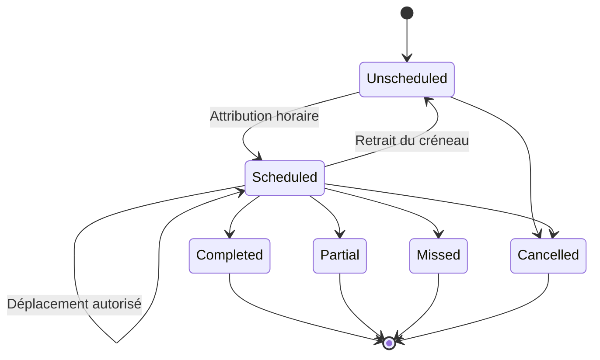

Statuts stockés : `active` (non placée si `planned_start_at` est nul), `to_confirm` (durée du
coach inconnue), `done`, `partial`, `missed`, `cancelled` ; une séance d'étude peut aussi être
`cancelled` (tâche terminée). Un travail réalisé n'est jamais
déduit du passage de l'heure : une séance d'étude passée non déclarée devient `missed`, son
temps est replanifié, et l'utilisateur peut encore la déclarer faite.

## 6. Entrées par domaine

### D06 — Synchronisation des sources

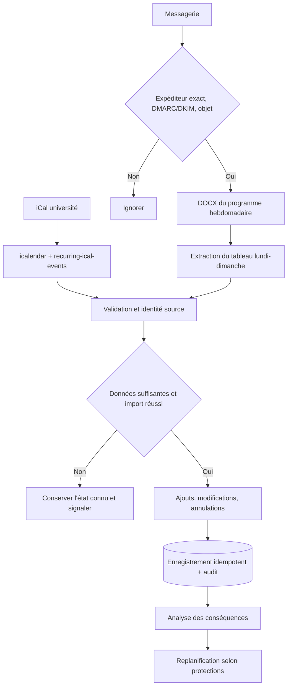

- **Université** (`sync/ics.py`, `sync/ics_repository.py`) : identité (UID, RECURRENCE-ID UTC) ;
  suppression logique avec historique ; flux vide ou plus de 50 % de suppressions (au moins 3)
  ⇒ sync `suspect`, suppressions retenues ; UID invalides jamais supprimés ; événements journée
  entière et repères de durée nulle (congés, échéances) jamais traités comme des engagements,
  signalés seulement s'ils tombent dans la fenêtre synchronisée ; verrou consultatif par
  source ; heures inexistantes (passage à l'heure d'été) normalisées, ambiguës résolues sur la
  première occurrence, avec avertissement ; une série déplacée est appariée par UID et mise à
  jour en place. Une panne ou un import partiel n'est jamais une suppression générale.
- **Sport** (`sync/coach_plan.py`, `sync/coach_import.py`, `sync/training_mail.py`) : seul
  l'expéditeur exact configuré est lu (filtre IMAP + revérification), et seulement si le
  serveur de réception de l'utilisateur (son `authserv-id`, réglage obligatoire) a enregistré
  DMARC aligné sur `header.from` ou DKIM aligné sur le domaine de l'expéditeur, dans le plus
  récent `Authentication-Results` à son nom (un en-tête écrit par l'expéditeur n'est jamais
  cru) ; boîte en lecture seule ; plan lu dans le `.docx` au format réel du coach (tableau
  « S3 | 23 au 29/11/2026 », puis lignes « Objectif », « Thème de la séance », « Contenu » suivies
  de 7 colonnes lundi→dimanche sans noms de jours ; ligne fusionnée ignorée ; apostrophes
  typographiques acceptées). Durée totale : celle du thème, sinon la première ligne du contenu
  si elle n'est qu'une durée (`1h15'`) ; `RAC : 10'`, `r 30''`, `3x80m` restent des parties. Jour suggéré (plan ou texte de l'e-mail) = préférence
  souple dans la semaine ; contenu conservé ; durée absente ⇒
  `to_confirm` (jamais devinée) ; ordre de la semaine conservé, récupération seulement si elle est
  explicite (`rest_days`, jamais déduite des jours suggérés) ; plan renvoyé ⇒ remplacement sans doublon, séances faites/verrouillées/modifiées par
  l'utilisateur jamais écrasées (proposition `coach_plan_change`) ; compétitions fixes avec
  approbation.
- **Études** : volume par tâche, échéance souple par défaut ; une échéance au-delà de
  l'horizon ne planifie que sa part proportionnelle à la capacité d'étude ; journal de travail
  idempotent, corrections négatives. **Examens** reconnus au titre iCal (« examen »,
  « partiel », « interrogation »… : `const.EXAM_WORDS`) : pas de tolérance de présence. Titre
  ambigu (« test », « évaluation », « contrôle », « épreuve », « QCM », « oral »… :
  `const.EXAM_DOUBT_WORDS`) ⇒ question « est-ce un examen ? » avant le cours, et en attendant
  toute la marge d'arrivée (côté sûr). La réponse (`set_exam`) vaut pour toute la série iCal
  (UID, réglage `exam_answers`).
- **Personnel** : rendez-vous fixes, sorties/activités flexibles dans une fenêtre ; durée
  inconnue ⇒ question, jamais de durée arbitraire.
- **Disponibilités** (un seul mécanisme, `planning.service.load_rules`) : fenêtres
  hebdomadaires d'étude (horaires seulement : l'utilisateur étudie là où il est), fenêtres de
  catégorie des activités, exceptions datées (un jour ou une plage) générales (toutes les
  activités flexibles) ou d'une catégorie, temps bloqué ou temps supplémentaire. Les
  engagements fixes restent prioritaires.

## 7. Localisation et transport

### D07 — Résolution de la localisation

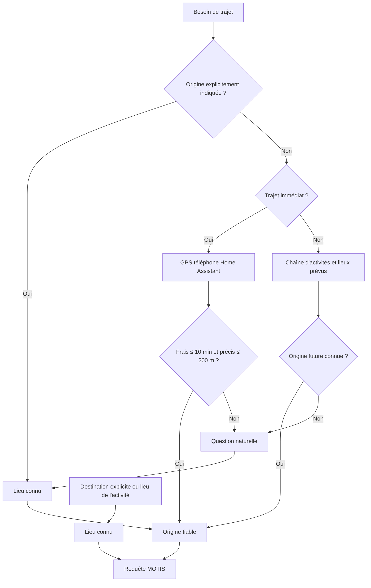

**Un seul modèle de présence** (`transport/location.py`, `planning/engine.route_outings`),
partagé par l'étude, le sport, les trajets, les résidences et les séjours :
- position réelle seulement si fraîche et précise (`assess_position`, aussi pour
  `get_position`), pour les trajets immédiats ; elle ne modifie jamais la présence prévue ;
- présence prévue : la base à un instant (`base_at` : lieu prévu couvrant l'instant, sinon
  résidence de l'alternance) ; chaque journée est **une sortie** : départ de la base au premier
  engagement situé, trajets **directs** d'un engagement au suivant, retour à la base en fin de
  journée (la base pouvant changer dans la journée : « je pars de chez papa et je rentre chez
  maman après les cours »). Aucun retour automatique entre deux activités ; un retour
  intermédiaire n'existe que si l'utilisateur le demande : un lieu prévu **compris dans
  l'intervalle** entre deux activités (« entre midi et 14 h je rentre »). Un lieu prévu qui
  couvre les activités (séjour de plusieurs jours, « je suis à Louvain-la-Neuve jusqu'à
  vendredi ») est seulement la **base temporaire** : point de départ du premier trajet et
  destination du dernier, jamais une raison de revenir entre deux cours (correction du 4/12 :
  l'ancienne règle « tout lieu prévu chevauchant l'intervalle » coupait chaque intervalle et
  produisait des allers-retours superflus et des trajets superposés). Un jour entièrement
  couvert par un lieu prévu ne pose pas la question de l'heure de changement de résidence ;
- base ou obligation : un lieu prévu court (dans une journée) qui chevauche un engagement
  ailleurs, ou une présence demandée que les trajets ne peuvent pas honorer, ⇒ question
  (« seulement votre point de départ, ou devez-vous rester à cet endroit ? ») ; en attendant,
  il est traité comme base, jamais comme obligation décidée par Tempo ;
- un entraînement sans lieu (« à la résidence ») n'a jamais lieu pendant un séjour hors des
  résidences ni pendant une période incertaine ; pendant une sortie, il reste possible mais
  fortement évité entre deux cours (préférence, C1) : s'il n'y a pas d'autre créneau, les
  trajets vers la maison et retour sont planifiés pour lui. L'étude se fait là où est
  l'utilisateur (résidence, université, séjour) ;
- **changement de base hors sortie** : aller à un lieu prévu (arrivée à son début), en revenir
  (départ à sa fin), passer à la résidence suivante à l'heure de changement donnée (départ à
  cette heure) sont des trajets obligatoires comme les autres ; un changement pendant une
  sortie est simplement son retour ;
- deux lieux prévus qui se chevauchent, un lieu iCal inconnu ou un jour de changement de
  résidence sans heure connue ⇒ question ; seule la période concernée est incertaine.
`get_location` donne à l'assistant où l'utilisateur est ou sera à un instant (GPS réel
maintenant, sinon trajet ou activité située prévus, sinon lieu prévu, sinon résidence de
l'alternance), avec la source utilisée.

Résidences multiples (générique, rien de personnel dans le code) :
- **Alternance** (`Alternation`, réglage `residence_alternation`) : résidences dans l'ordre de
  rotation, changement tous les `period_days` jours ; le jour du changement, l'utilisateur part
  de la résidence en cours, va à l'université et rejoint la suivante **après la fin officielle
  du dernier cours** (`db.store.residence_alternation` résout ce moment depuis l'emploi du temps,
  présence partielle comprise). Sans cours ce jour-là, Tempo demande l'heure
  (`set_residence_switch`, réglage `residence_switches` par date) ; jamais d'heure fixe
  arbitraire (`switch_at` seulement si l'utilisateur donne une heure pour tous les
  changements). Une seule déclaration datée initialise l'alternance
  (`set_residence_alternation`), la redéclarer est un changement définitif,
  `get_residence_schedule` la montre avec ses exceptions. Les **lieux prévus**
  (`set_planned_location`) sont des exceptions temporaires : ils priment sans décaler la
  récurrence ; une nouvelle exception (ou `clear_planned_location`) ne retire que la période
  qu'elle recouvre. Une seule résidence = alternance d'un lieu (jamais de question).
- **Point d'accès aux transports** par lieu, un seul par défaut et persistant
  (`access_place_id` + `access_minutes`, les deux ou aucun, contrainte en base ; durée donnée
  par l'utilisateur, jamais devinée). Un point d'accès différent pour **un seul** trajet se
  donne en conversation (`search_journey` : `access_place_id`, `access_minutes`,
  `access_side`) et n'est jamais enregistré ; pour une **période** (« cette semaine on me
  dépose à la gare »), `set_temporary_access` / `clear_temporary_access` (réglage JSON
  `access_overrides`) s'appliquent aussi aux trajets planifiés et aux départs de cette période,
  prioritaires sur l'accès par défaut qui reste inchangé. Un seul adaptateur de routage
  (`transport/access.py`, `db.store.access_routing`) interroge MOTIS depuis/vers le point
  d'accès et ajoute une étape `ACCESS` de durée fixe ; il sert à la planification, aux trajets
  du jour, au contrôle de départ (GPS à moins de 300 m du lieu compris) et aux recherches.
- **Résidences** : uniquement l'alternance, toutes à égalité ; plus de réglage
  `home_place_id` ni d'option HA « zone domicile ». Sans résidence, la planification demande où
  l'utilisateur habite.
- **Trajets** : automatiques pour les cours et examens ; pour un autre événement avec un lieu,
  l'assistant demande s'il faut planifier l'aller et le retour (`create_event.remote`).
- **Préférences d'entraînement** (réglage `training_preferences`, actives par défaut, permanentes
  ou temporaires) : jours sans cours ; moment de la journée `time_of_day` (matin par défaut,
  puis après-midi, soir en dernier ; `afternoon` ou `evening` quand l'utilisateur préfère
  l'après-midi ou le soir, `none` sans préférence ; une séance compte selon son milieu :
  avant 12:00, avant 18:00, après) ;
  éviter fortement le noir pour une séance extérieure (`indoor` sinon ; lever et coucher du
  soleil à la résidence de référence, la première de l'alternance, les résidences étant proches ;
  bibliothèque `astral`) ; éviter l'entre-deux-cours. Préférences, jamais interdictions (§8). Les
  lieux autorisés, l'ordre du coach, la semaine et la récupération explicite restent des
  contraintes dures.
- **Heures transmises au modèle** : les horodatages des résultats d'outils sont convertis
  dans le fuseau configuré avant d'être donnés à Gemini (constaté en production : le modèle
  lisait des heures UTC comme locales, cours de l'après-midi et bus annoncés une heure trop
  tôt).
- **Clarification** (dans la conversation, sans couche supplémentaire) : une seule règle de
  la consigne système de l'agent : chaque valeur passée à une modification vient de
  l'utilisateur, d'un résultat d'outil, ou est omise pour garder le défaut documenté du champ ;
  si une valeur manque ou si plusieurs lectures changent ce qui serait modifié (ponctuel ou
  permanent, période, lieu, élément), aucune modification, même réversible : une question, puis
  exécution avec la réponse combinée à la demande en attente. Les champs obligatoires des
  opérations (ex. durée d'accès) restent refusés s'ils manquent. Gemini est appelé avec un
  raisonnement « medium » : vérifié avec le vrai Gemini (`gemini-3.5-flash-lite` et
  `gemini-3.5-flash`), il ne pose plus 18:00 pour « vendredi soir » et demande « Je vais chez
  papa » (loger ou trajet ? dès maintenant ?) au lieu de créer une exception. Limite connue :
  le modèle léger interprète parfois une réponse groupée (« juste ce week-end ») pour deux
  questions à la fois.
- **Itinéraires irréalistes** rejetés : durée porte-à-porte maximale `max_journey_minutes`
  (180 par défaut, réglable en conversation), transmise à MOTIS (`maxTravelTime`) et
  revérifiée accès compris. Toutes les activités situées (cours, rendez-vous, entraînements, compétitions,
sessions de tâches situées, études hors base) reçoivent leurs trajets. Un texte de lieu iCal inconnu
bloque le temps sans trajet et est signalé (ajouter un alias). Coordonnées jamais devinées. Une
adresse dite par l'utilisateur est cherchée par `find_address` dans le géocodeur local de MOTIS
(`geocoding: true`, données OpenStreetMap du graphe, rien n'est envoyé ailleurs) ; l'assistant
relit les correspondances et ne crée le lieu qu'avec celle que l'utilisateur confirme.

### D08 — Données et moteur de transport

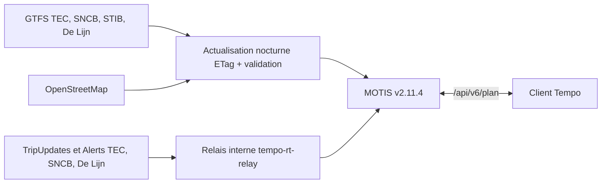

Faits vérifiés par requêtes réelles (23 et 25/11/2026) :
- Belgian Mobility Open Data : 4 GTFS statiques + TripUpdates et Alerts pour TEC, SNCB et
  De Lijn, uniquement par la passerelle authentifiée
  `api-management-opendata-production.azure-api.net/api/gtfs/feed/<op>/...` (centralisée dans
  `transport/feeds.py`), clé **obligatoire** dans l'en-tête `bmc-partner-key`, envoyée à ce
  seul hôte. Aucun accès anonyme. `?format=protobuf` obligatoire pour le temps réel ;
  TripUpdates avec `unroll=off` (arrêts sans prévision omis, données identiques, ~30 % plus
  léger). STIB : GTFS statique seulement. MOTIS est la seule source d'itinéraires : les
  trajets STIB (et tout exploitant sans temps réel) suivent le GTFS statique.
- Quota indicatif (conditions d'utilisation §5) : Standard 12 000/jour et 500/min ; au-delà,
  la passerelle peut répondre 429.
- Clé absente : le relais refuse de démarrer et la mise à jour des données s'arrête, chacun
  avec un message nommant le secret `tempo_bmc_partner_key` ; clé refusée (401/403) :
  journalisée et visible dans `/health` du relais, ou dans le rapport de la mise à jour.
- `/health` distingue `operational`, `degraded`, `stale`, `unavailable` et `invalid` par flux.
  Il publie la date de dernière récupération valide, le timestamp et l'âge du message, la
  latence du portail, les échecs consécutifs, les compteurs des messages et les opérateurs ayant
  seulement du statique. Les compteurs de rapprochement restent dans les journaux MOTIS.
- Les étapes transmettent les heures et quais prévus, les quais indiqués par MOTIS, les arrêts
  intermédiaires signalés supprimés et l'origine de chaque horaire quand MOTIS la publie.
  Les correspondances exposent le temps restant après les étapes de transfert. Le planning
  indique aussi le temps jusqu'au début de l'engagement. iCal et Home Assistant utilisent le
  même rendu, y compris pour un itinéraire de secours, des arrêts supprimés et des marges
  de correspondance. Une marge calculée ne garantit pas la correspondance.
  MOTIS v2.11.4 expose la provenance de la prévision mais ne transmet pas le timestamp
  de l'entité GTFS-RT. Tempo qualifie donc la fraîcheur individuelle de ces prévisions
  d'inconnue dès le calcul et de périmée après 90 s au plus. Ce traitement couvre également
  les prévisions dans les anciennes versions.
- Interrogation : TripUpdates toutes les minutes (l'éditeur publie toutes les 30 s), alertes
  toutes les 5 min, pour les six flux : 5 184 requêtes/jour, soit 43 % du quota (54 % du
  plafond de 80 % que le relais s'impose) ; s'y ajoutent au plus 4 téléchargements statiques
  par jour. MOTIS interroge le relais (interne, gratuit) toutes les 30 s.
- Ce que fait MOTIS nativement (v2.11.4, sources lues) et que Tempo ne refait pas : interrogation
  à intervalle fixe, en-têtes par flux, abandon du temps réel d'un flux en échec
  (`incremental_rt_update: false`), donc retour aux horaires statiques. Ce qu'il ne fait pas,
  seule raison d'être du relais : quota, 429/`Retry-After`, rejet d'un flux périmé, réparation
  des `start_time` TEC.
- Relais (`transport/rt_relay.py`, une seule réplique) : détient la clé, plafonne à 80 % du
  quota, recul exponentiel. Un 429 suspend **tous** les flux (le quota est par compte) jusqu'à
  `Retry-After` (secondes ou date HTTP, jamais raccourci, au moins 5 min) ; un 401/403 est
  journalisé comme clé refusée. Le relais sert les copies pendant 90 s pour les TripUpdates et
  10 min pour les alertes. Il vérifie aussi chaque timestamp de TripUpdate au moment du
  service et filtre les entités anciennes, futures ou non datées. Les alertes sans timestamp
  restent consultatives. À expiration de l'en-tête, le relais répond 503, puis MOTIS revient
  au statique à sa prochaine interrogation. Le relais rejette les instantanés incomplets ou différentiels, les
  timestamps incohérents et les retours en arrière. Il retire `start_time` des TEC (décalage
  de 12 h en amont, résolution 50 % → 100 %). [Recommandations GTFS Realtime](https://gtfs.org/documentation/realtime/realtime-best-practices/).
- Alertes : consultatives, jamais d'exclusion de trajet ; signalées seulement si leur période
  d'impact chevauche le tronçon ET si leur texte nomme sa ligne ou l'un de ses arrêts (MOTIS
  attache aux tronçons d'un exploitant ses avis sur tout le réseau ; les avis sans période ne
  sont jamais signalés) ;
  annulations et retards viennent des TripUpdates. Un retard réel de +7 min a été observé.
- MOTIS national : import 3 min 29 s, 1,8 Go, serveur 0,7–0,9 Go, requête médiane 100–130 ms.

Le pipeline conserve le téléchargement conditionnel et les identifiants des opérateurs.
Il vérifie les colonnes des archives et les références `trip_id`, `stop_id` et
`service_id`, en plus de l'intégrité, de la taille et de la couverture des dates.
Il publie par remplacement de `READY` un lot versionné contenant toutes les sources
requises. Un échec laisse le lot précédent en service. Le superviseur importe le lot exact,
démarre le candidat sur la boucle locale et vérifie santé, itinéraire de référence, arrêts
des opérateurs et routage piéton. Il essaie ensuite le port de service et restaure le
lien précédent en cas d'échec.
Le catalogue belge de Transitous emploie des variantes de sources et, pour la SNCB, un script de
transformation. Son pipeline `gtfsclean` sait réparer et minimiser des flux. Sa compatibilité
avec les identifiants des quatre flux de Tempo demande une recette sur les archives réelles.
Le validateur MobilityData apporterait des contrôles de conformité plus étendus avec un
runtime Java supplémentaire. [Catalogue belge Transitous](https://github.com/public-transport/transitous/blob/main/feeds/be.json) ·
[gtfsclean](https://github.com/public-transport/gtfsclean) ·
[Validateur MobilityData](https://github.com/MobilityData/gtfs-validator).

Contrat de recherche (`search_journey`) : origine et destination quelconques (`place:<id>`,
`activity:<id>`, `event:<id>` pour un cours, `gps` pour un trajet immédiat) ; bornes : arrivée
avant, départ après ou plage, par défaut déduites des activités (fin de l'origine, début de la
destination) ; une borne seule ⇒ fenêtre réglable (`window_minutes`, 2 h par défaut, jusqu'à
24 h) ; objectif (durée minimale par défaut, arrivée au plus tôt, départ au plus tard) ;
critères (correspondances, marche) ; nombre d'alternatives (`max_alternatives`, 3 par défaut,
jusqu'à 10) ; retour facultatif. La pagination s'adapte à la fenêtre (environ une requête par
demi-heure, de 5 à 20). Statuts : `ok` (meilleur + alternatives, « meilleur parmi les candidats
explorés », `exploration_incomplete` si une page suivante a échoué), `no_candidate`,
`origin_unknown`, `place_unknown`, `unavailable`, `error` (panne, jamais présentée comme
impossibilité). Le temps réel reste distingué en interne (`realtime` par trajet et par
segment).
Toute sélection d'itinéraire passe par `itinerary.find_trips` (MOTIS calcule, Tempo choisit
selon le contexte) :

| Contexte | Bornes | Objectif |
|---|---|---|
| Aller vers un engagement | départ après l'engagement précédent, arrivée avant le début − marge (10 min) | départ au plus tard |
| Trajet direct entre deux engagements | départ après le premier, arrivée avant le second − marge | départ au plus tard |
| Retour à la base (fin de journée ou changement de résidence) | départ après la fin, arrivée avant la sortie suivante du jour (sinon 6 h) | arrivée au plus tôt |
| Estimation d'une activité flexible avant placement | depuis la base autour de l'heure préférée (6 h) ; corrigée ensuite par les trajets réels du plan final | durée minimale |
| Contrôle de départ | départ maintenant, arrivée avant le début − marge ; sinon au plus tôt | départ au plus tard, puis arrivée au plus tôt |
| Recherche en conversation | choisies par l'utilisateur (2 h autour d'une borne seule) | choisi par l'utilisateur |

Tolérance de cours (`class_tolerance_minutes`, 10 min par défaut, au plus 30, réglée en
conversation) : pour les **cours** seulement, l'utilisateur accepte au plus d'arriver ce nombre
de minutes après le début et de partir autant avant la fin. C'est une **contrainte souple** :
les trajets arrivant avant le début officiel (marge comprise) et partant après la fin
officielle sont cherchés d'abord ; un trajet qui consomme de la tolérance (arrivée après
« début − marge », départ avant la fin) n'est retenu que s'il économise davantage que sa
pénalité, `TOLERANCE_PER_MINUTE` (6, `tempo/const.py`) minutes d'attente ou de trajet par
minute consommée — 8 minutes de tolérance ne servent qu'à éviter près d'une heure d'attente ;
sans meilleur itinéraire, la tolérance est utilisée, jamais au-delà du maximum. Le trajet
publié se termine au début officiel, ou après lui seulement de ce qui est réellement consommé.
Une présence partielle explicite (« j'arrive à 10 h ») remplace les heures et ne reçoit pas de
tolérance en plus. Les **examens** et les
autres engagements gardent leurs heures exactes et toute la marge d'arrivée. La tolérance ne
change jamais l'heure affichée : les trajets publiés portent l'heure officielle de début
(`event_start`), seule montrée avec l'heure de départ dans les notifications.

Présence à une séance de cours (`set_class_attendance`, réglage `class_attendance` par
occurrence `event:<id>`) : « absent » (pas de trajet, le créneau est libre), « partiel » (heures
d'arrivée et/ou de départ dites par l'utilisateur, dans le cours, sans tolérance en plus ; ex.
partir à 16h pour un train) ou « complet » (retour à la normale). Le cours iCal lui-même n'est
jamais modifié ; `get_schedule` montre la présence déclarée sur la séance.

Départage : perturbations sévères datées, puis correspondances. Toutes les alternatives
acceptables explorées sont conservées sur chaque trajet du planning publié. Aucun trajet ⇒
`impossible` ; panne ⇒ l'itinéraire du même trajet dans le plan publié est conservé (`stale`,
non revalidé, rafraîchi automatiquement), sinon `unknown` : le temps est bloqué prudemment, au
plus la durée de trajet maximale, et le problème signalé. Aucune durée de trajet n'est
inventée. Un trajet non confirmé empêche le statut `complete`. Une exécution de planification
partage un cache : une requête identique n'atteint MOTIS qu'une fois.

## 8. Planification

### D10 — Replanification

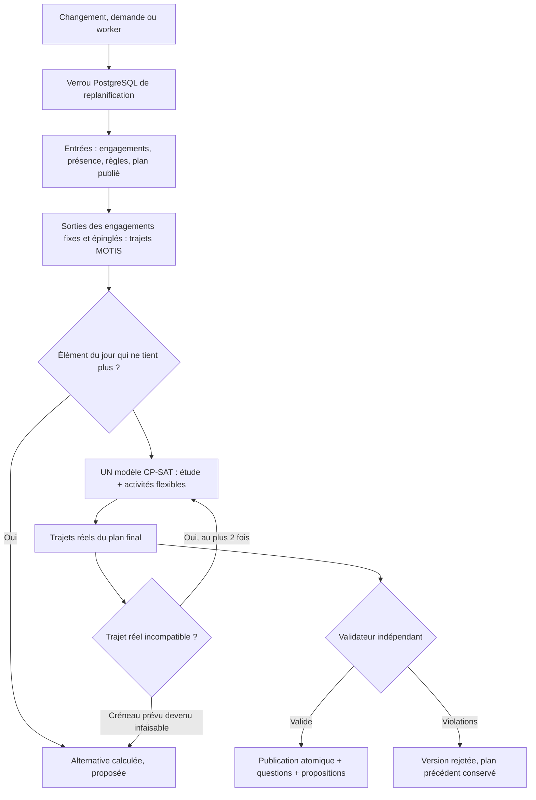

Pipeline (`planning/engine.py`, fonction pure) : engagements fixes (cours, examens,
compétitions, activités fixes, verrouillées, en cours, et éléments du jour épinglés) → sorties
du jour et présence (`route_outings`) → un seul solveur (`scheduler/solver.py`) pour l'étude
et toutes les activités flexibles → trajets réels du plan final → corrections bornées →
validateur indépendant (`scheduler/validate.py`) sur le plan final.

La demande de recalcul porte une révision. Le service acquitte la révision lue avec
les entrées dans la transaction qui publie le plan. Un calcul rejeté, une simulation
ou un arrêt laisse la demande disponible. Une écriture concurrente est préservée.

**Contraintes dures** (solveur et validateur, jamais relâchées) :
- aucun chevauchement entre engagements, trajets, périodes incertaines, séances et activités ;
- chaque séance d'étude tient dans une plage de disponibilité continue. Les fenêtres et plages
  autorisées des activités restent obligatoires
  (fenêtres de catégorie, indisponibilités générales ou par catégorie, séjour ailleurs ou période
  incertaine pour un entraînement sans lieu) ;
- toutes les échéances (souples et strictes) : aucun travail après sans accord ;
- éléments verrouillés, en cours et épinglés gardés tels quels ;
- ordre de la semaine du coach entre toutes les séances placées ; récupération explicite (`rest_days` de la séance ou réglage
  `training_preferences.rest_days`, jamais déduite) ;
- trajets faisables (MOTIS, ou itinéraire précédent conservé pendant une panne) ;
- séquence physiquement possible (`validate_journeys`, sur le plan final) : jamais deux
  trajets en même temps ; chaque trajet part de là où est l'utilisateur (activité ou arrivée
  précédente du jour) et l'engagement suivant est à sa destination ; un trajet ne recouvre un
  cours que dans la limite de sa tolérance (jamais un examen ni un autre engagement). Deux
  engagements fixes simultanés à des endroits différents sont un conflit de sources (signalé
  pour arbitrage), pas une erreur de trajet ;
- longueur des séances (30 à 90 min), grille de 15 min.

**Préférences souples** (coûts du solveur, jamais plus fortes que placer le travail) : heures
d'activité ; obscurité pour un entraînement extérieur ; entraînement entre deux cours ; jours
de cours, puis après-midi, puis soir pour un entraînement ; heure préférée d'une activité ; jour
suggéré du coach ; stabilité ; répartition régulière jusqu'à l'échéance ; alternance des
matières (pas la même matière dans l'heure, ni juste après son cours) ; pause de 15 min ;
séances de 90 min.

**Priorités** : une seule règle pour toutes les activités flexibles. Laisser du travail non
planifié coûte 5 000 par minute × priorité (1 à 3), quelle que soit la catégorie (étude,
entraînement, sortie, séance de tâche) ; 1 250 par minute × priorité pour une tâche sans
échéance (elle utilise le temps restant sans jamais compromettre une échéance réelle). La
priorité n'agit donc que lorsque le temps manque ; aucune catégorie n'est planifiée avant une
autre (un seul modèle).

**Coefficients** (`const.py`, équilibre vérifié par `tests/test_scheduler.py`) :

| Coût | Valeur | Rôle |
|---|---|---|
| Hors heures d'activité | 40 000 | fortement évité |
| Noir, entraînement extérieur | 30 000 | fortement évité, jamais interdit |
| Écart à l'heure préférée d'une activité | 15 000 + 10/min | bat les préférences générales, pas le noir |
| Entraînement entre deux cours | 10 000 | C1 |
| Jour de cours (entraînement) | 8 000 | jours sans cours d'abord |
| Moment de la journée (entraînement) | 1 000 période voisine / 3 000 opposée | matin par défaut ; après-midi ou soir sur demande |
| Jour suggéré du coach | 500 par jour d'écart | |
| Stabilité | 4 000 / (jours d'avance + 1) + décalage | demain 2 000, dans une semaine ~500 |
| Au-delà de la part quotidienne régulière | 5 par minute | répartition jusqu'à l'échéance |
| Même matière rapprochée / pause manquée / séance courte | 400 / 150 / 100 | |

La somme des préférences qu'un élément peut cumuler reste inférieure au coût de le laisser
non planifié (test). La part quotidienne régulière vaut le travail restant divisé par les jours
utiles avant l'échéance, au moins une séance de 90 min.

**Valeurs par défaut configurables** (`const.py`, `SETTING_DEFAULTS`, modifiables en
conversation, la valeur en base prime) : horizon 14 jours, marge d'arrivée 10 min (examens
compris), tolérance de cours 10 min (jamais pour un examen), rappels de départ 60 et 15 min,
trajet maximal 180 min, heures d'activité 06:00–22:00, séances 90 min (30 à 90), pause 15 min,
écart de matière 60 min, préférences d'entraînement actives (jours sans cours, `time_of_day`
matin, éviter le noir), récupération 0 jour.

**Horizon** : plan détaillé glissant de 14 jours. Une échéance plus lointaine planifie
maintenant la plus grande de deux parts : sa part proportionnelle à la capacité d'étude de
l'horizon, et ce que la capacité connue après l'horizon ne pourra pas absorber. Les échéances
sont prises dans l'ordre (la plus proche d'abord, avec le travail des précédentes) et la
capacité tient compte des disponibilités, exceptions, cours et événements fixes connus jusqu'à
l'échéance (iCal sur 60 jours). Si le travail cumulé dépasse la capacité avant une échéance,
un avertissement est notifié.

**Stabilité** : déplacer un élément publié coûte d'autant plus qu'il est proche (nombre
d'éléments déplacés, amplitude du décalage, temps restant) ; le jour même, il est épinglé.
Mode `global` uniquement sur demande explicite (stabilité ignorée, verrouillé et en cours
protégés). Les blocs d'étude précédents encore admissibles alimentent les indications de
démarrage de CP-SAT avec les créneaux gloutons. Chaque bloc ne peut tenir lieu que d'un seul
bloc antérieur dans le coût de stabilité. Le diff compare les activités par identifiant
persisté, y compris les annulations, et les trajets par champs métier. Les séances d'étude
ambiguës restent des ajouts et retraits distincts. Les déplacements et changements de durée
sont comptés séparément.

**Opérations automatiques** : synchronisation iCal (immédiate), réoptimisation à partir du
lendemain, nouvelles placements dans le temps libre du jour, rafraîchissement des trajets non
confirmés dès que MOTIS répond, rappels, contrôle de départ.

**Opérations soumises à accord** (`proposal`) : déplacer un élément déjà prévu aujourd'hui
(`move_activity`, `move_block` : le créneau proposé est réservé jusqu'à la décision ; refus ⇒
pas de nouveau placement ce jour-là), déplacer une activité dont l'itinéraire réel ne permet
plus le créneau prévu, déverrouiller (`unlock_block`, `unlock_activity`), changement du coach
sur une séance protégée, import d'e-mail interprété par LLM, planifier au-delà d'une échéance
(via les alternatives simulées puis `update_task`).

**Situations et statuts** (`summary.status`) : `complete` (tout est placé, tous les trajets
confirmés par MOTIS, aucune question ni accord en attente) ; `partial` (travail ou activité non
placé, trajet non confirmé, question ouverte : détail dans le résumé) ; `pending_approval` (seuls
des déplacements attendent l'accord) ; `no_solution` (solveur sans réponse dans son temps :
inconclusif, l'ancien plan reste) ; `invalid` (violation : rien n'est publié). Échéance
impossible : la partie réalisable est planifiée, `deadline_misses` et `deadline_capacity`
(minutes nécessaires et libres) l'expliquent, `propose_alternatives` simule reporter (+2, +7,
+14, +28 j) ou réduire le volume.

**Pannes et informations manquantes** : lieu iCal inconnu ⇒ question, temps bloqué autour du
cours (au plus le trajet maximal), reste du plan publié ; jour de changement de résidence sans
cours ⇒ question, seule cette journée est incertaine pour les entraînements à la résidence ;
panne MOTIS ⇒ itinéraire précédent du même trajet conservé (`stale`, non revalidé), sinon temps
bloqué prudemment (au plus le trajet maximal), plan `partial`, recalcul automatique toutes les
15 min ; solveur sans réponse ou violation ⇒ l'ancien plan reste actif. Une panne technique ne
détruit jamais le dernier plan valide.

**Performance** : un solve de 10 s au plus (démarrage glouton, arrêt sur borne prouvée), au plus
deux corrections de 5 s ; deux semaines, six matières et quatre entraînements : plan complet en
moins de 15 s sur le poste de développement.

### D11 — Diagnostic des résultats

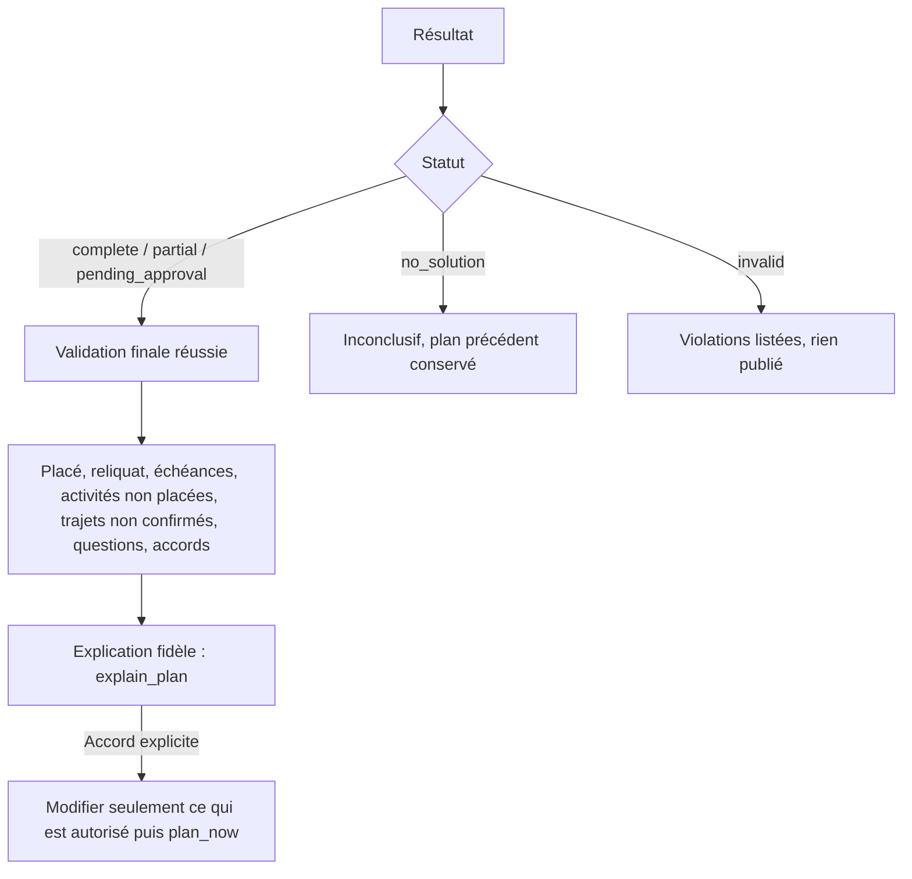

Exemple vérifié par test : « 50 h de chimie avant demain, stricte » ⇒ statut `partial`,
minutes non planifiées par tâche, échéance stricte signalée comme manquée, jamais comme
réussie. `explain_plan` donne pour chaque échéance stricte manquée la cause chiffrée
(`deadline_capacity` : minutes nécessaires et minutes d'étude libres avant l'échéance, après
engagements, trajets et entraînements). Le calcul de capacité représente l'union des fenêtres
libres et s'arrête aux limites de la tâche et de l'horizon. L'effort distingue les minutes
réservées, avant et après l'échéance, les minutes restant à faire ou à placer et le travail
enregistré. Un bloc verrouillé tardif reste réservé et laisse l'échéance non couverte.
La capacité optimiste ignore les activités flexibles. Elle donne un manque minimal chiffré
dans l'horizon courant. Les noyaux CP-SAT nécessiteraient de rendre obligatoires des contraintes
que le modèle optimise aujourd'hui avec le reliquat. Le diagnostic garde la distinction entre
capacité prouvée et résultat partiel, avec un seul modèle. [Assumptions CP-SAT](https://github.com/google/or-tools/blob/v9.15/ortools/sat/docs/troubleshooting.md).
`propose_alternatives` simule ensuite, sans rien publier ni modifier, des alternatives
déterministes par tâche touchée (au plus 3) : reporter l'échéance (plus petit report essayé
parmi +2, +7, +14, +28 jours qui résout), rendre souple une échéance stricte, réduire le volume
à ce qui tient. Chaque alternative donne le résultat réel de sa simulation (reliquat, retard,
échéance stricte manquée). Élargir une disponibilité reste une simulation `dry_run` de
l'assistant (les heures à ouvrir sont un choix de l'utilisateur). Rien n'est appliqué sans
accord.

## 9. Validation, propositions et concurrence

### D14 — États d'une proposition

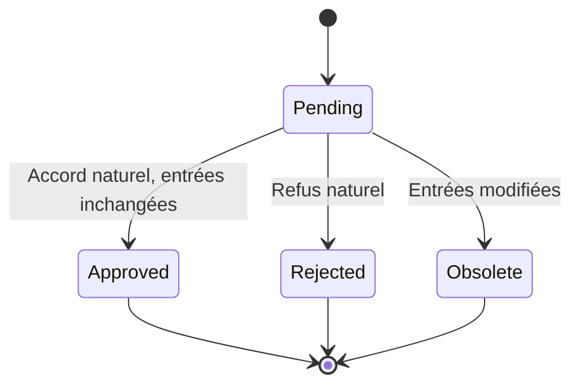

- **Un seul mécanisme d'accord** : la proposition (`move_activity`, `move_block`,
  `unlock_block`, `unlock_activity`, `coach_plan_change`, `training_import`,
  `plan_changes`) enregistre l'empreinte de son entrée (`input_revision`). À l'accord,
  une empreinte différente rend la proposition obsolète. Le prochain aperçu d'un lot
  conversationnel doit être demandé dans Assist.
- Conflits entre engagements de toutes catégories (cours, compétitions, rendez-vous fixes,
  activités verrouillées), détectés en un seul endroit (`planning/engine.find_conflicts`) et
  repris dans le résumé de chaque version, même rejetée : une activité flexible verrouillée en conflit produit une
  proposition de déverrouillage, une séance d'étude verrouillée aussi ; deux engagements fixes
  produisent une notification de conflit (rien ne bouge). Une activité déjà commencée n'est
  jamais déplacée ni proposée. Changement iCal (même le jour même) : le cours officiel est
  enregistré immédiatement ; les éléments du jour qu'il déplace font l'objet d'une proposition
  `move_*` (créneau proposé réservé jusqu'à la décision, obsolète une fois son heure passée) ;
  à partir du lendemain, la réoptimisation est automatique. Accepter applique le créneau
  proposé (sans verrouiller) ; refuser libère l'élément, qui n'est plus replacé ce jour-là. Les
  rappels relatifs suivent le planning publié, jamais une proposition.
- Accord et refus se font en conversation (`decide_proposal` sur une proposition identifiée,
  uniquement sur réponse explicite).
- Les questions du planificateur et des sources passent par
  `db.store.notify` (dédupliquées par clé). Les notifications
  `question` persistantes (redémarrages compris) avec leur échéance (`due_at`) et leur
  résolution (`resolved_at`, distincte de l'affichage : Home Assistant acquitte à la remise
  sans répondre).
  - Questions du planificateur et des sources (lieu iCal inconnu, jour de changement sans
    cours, examen incertain : une seule question par série, texte stable) : affichées une fois
    dans Home Assistant (notification persistante), closes quand le dernier plan ne les soulève
    plus, rouvertes si elles reviennent (sans nouvelle notification).
  - À chaque message, Tempo transmet à Gemini la question du planificateur la plus urgente.
    Tempo peut l'ajouter à sa réponse informative ou après une opération directe. Un changement
    du planning sans recalcul dans le tour est recalculé à la fin du tour. Une clarification
    active est présentée dans la réponse de son fil et conservée dans sa proposition (§4).
  - Ouverture d'Assist : vérifié dans Home Assistant 2026.11.2, l'interface n'envoie à l'agent
    que `conversation/prepare` (préchargement, aucune réponse affichable) : un agent ne peut
    pas parler le premier. La première interaction possible est le premier message de toute
    conversation (« bonjour » suffit) ; la question reste aussi en notification. Seuls les
    satellites vocaux déclarant `START_CONVERSATION` acceptent
    `assist_satellite.start_conversation` / `ask_question` (non utilisé : aucun satellite).
  - Une information manquante ne bloque que l'élément et la période concernés (§8).

## 10. Worker, rappels et notifications

### D15 — Cycle autonome

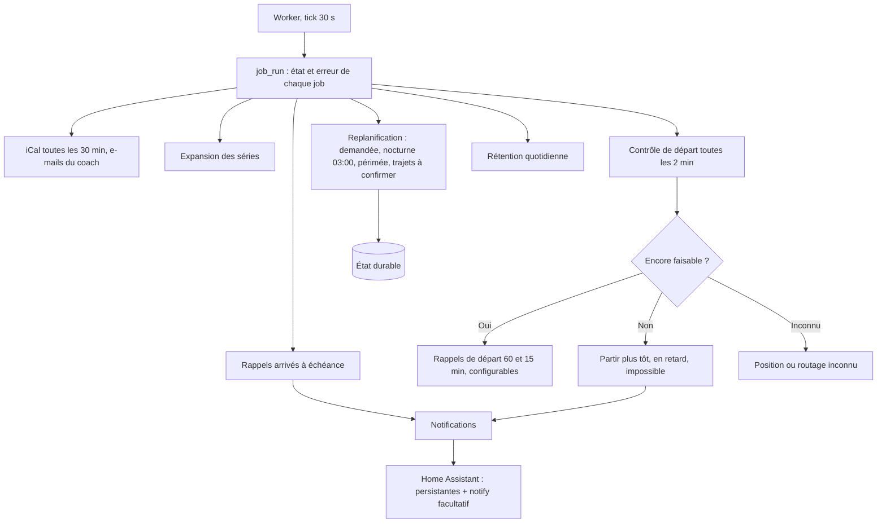

- Rappels utilisateur (`reminder`) : à heure fixe (éventuellement RRULE) ou N minutes avant une
  activité ou un cours ; l'échéance est recalculée depuis la cible à chaque contrôle (un
  déplacement déplace le rappel, une annulation l'annule). Identité = rappel + instant dû :
  pas de doublon après redémarrage ; un rappel manqué pendant une panne part au redémarrage
  (jusqu'à 6 h, marqué « en retard »).
- Rappels de départ : plusieurs seuils (`update_settings.departure_reminder_minutes`) ; le
  message ne donne que l'heure officielle de début et l'heure de départ ; sur le
  prochain trajet aller (jamais un retour à la base), recalculés avec la position réelle et le
  temps réel ; sans position fiable ou sans routage, l'utilisateur est averti et les rappels
  suivent le départ du planning publié, en le disant.
- Notifications créées par une seule fonction backend, dédupliquées par clé (une panne de
  routage : une notification par jour) ; Home Assistant les affiche et les acquitte à la
  remise, sans en fabriquer d'autres ; informatives uniquement (aucune action).
- Aucun job ne dépend du LLM ; l'import d'e-mails par LLM (texte libre) passe par une
  proposition à approuver.
- Le worker et les écrivains des entrées du planning prennent le verrou consultatif avant
  les verrous de lignes. Le worker enregistre la tentative et la révision dans une courte
  transaction. La publication du plan, l'acquittement et l'historique de succès partagent
  ensuite une transaction. Une interruption conserve la demande. Le délai de retry s'applique
  à la même révision. Les cycles sans calcul préservent `job_run`. Procrastinate fournit file persistante, exécutions
  périodiques, verrous, retries et récupération des jobs interrompus via une tâche de reprise.
  Les jobs Tempo recalculent principalement depuis l'état métier PostgreSQL. Une migration
  ajouterait un schéma de file et sa supervision pour cette charge. [Procrastinate](https://procrastinate.readthedocs.io/en/stable/).

## 11. Déploiement et exigences non fonctionnelles

### D16 — Déploiement cible

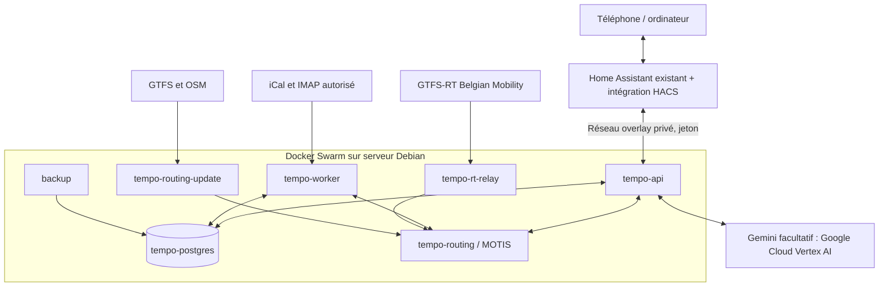

- Réseaux : `backend` et `routing` internes ; `ha` partagé avec Home Assistant ; `egress` pour
  le worker (iCal, IMAP), le relais, la mise à jour des données et l'API (LLM seulement).
  PostgreSQL et le relais ne sont jamais publiés.
- Sécurité : jeton de service fort (≥ 16 caractères distincts), rotation avec un jeton précédent,
  comparaison à temps constant, blocage après 10 échecs/60 s (429), `/health` seul public,
  OpenAPI désactivé côté HTTP ; secrets Docker (`/run/secrets`) ; images non root, système de
  fichiers en lecture seule, dépendances épinglées ; deux rôles PostgreSQL (propriétaire DDL,
  rôle applicatif DML, audit en ajout seul) ; logs sans jeton ni données personnelles.
- Fiabilité : migrations Alembic sérialisées par verrou consultatif ; transactions et points de
  sauvegarde ; versions de planning ; sauvegarde quotidienne + exercice de restauration ;
  health checks (API, relais, worker par battement, MOTIS) ; retries bornés ; calculs en UTC,
  règles en heure locale (sûr aux changements d'heure). Mise à jour des données de routage
  chaque nuit (02:30 UTC) sur le nœud qui porte MOTIS (volume local partagé, contrainte de
  placement `node.role == manager`).
- Performance : horizon glissant (14 jours par défaut, cibles lointaines conservées en part
  proportionnelle), séries matérialisées sur 60 jours, solveur limité à 10 s.
- Observabilité : `/health` reste le contrôle de vie pour Docker et Uptime Kuma.
  `/v1/diagnostics` authentifié combine les statistiques PostgreSQL, l'historique `job_run`,
  le dernier succès des jobs, le dernier signal du worker et les états de MOTIS et du relais.
  La projection autorise des champs et types précis, avec un code d'erreur public. Les journaux donnent les durées et les statuts de
  l'API et de MOTIS sans les paramètres des requêtes. Gemini journalise la durée de ses appels
  réussis et l'API signale ses pannes. Docker et Glances restent les sources pour les ressources
  de l'hôte. Une collecte OpenTelemetry exigerait une destination de télémétrie adaptée.
- Pas de dépendance à Claude Code en production.

## 12. État réel et recette

Légende : **Vérifié** = test automatisé sur PostgreSQL réel (et MOTIS réel quand indiqué) ;
**Partiel** = implémenté, une partie de la vérification manque ; **Non** = non fait.

| Besoin | État | Preuve / écart |
|---|---|---|
| B01 Conversation | Partiel | Client Gemini simulé et PostgreSQL réel (`tests/integration/test_assistant.py`). Le scénario de Solre-sur-Sambre vérifie la reprise du travail, l'annulation de l'entraînement, la conservation du souper et l'absence de trajet associé au travail. Les tests couvrent les précisions successives, l'isolation par fil et utilisateur, l'expiration, le refus, l'atomicité et les reprises. Gemini réel a été testé le 26/11/2026 sur les anciens parcours. La nouvelle sélection des outils de clarification par Gemini réel reste à vérifier. Le contrat avec le client Home Assistant est couvert par `test_ha_contract.py`. |
| B02 Événements | Vérifié | Fixe, flexible, journée entière occupée/informative, plusieurs jours, série + exception + « suivantes » + série entière, verrouillage (`test_operations.py`). |
| B03 Tâches | Vérifié | Sans durée puis estimée, planifiée, progression partielle idempotente ; fractionnement demandé au-delà de 90 min, indépendant du lieu ; tâche située fractionnable en plusieurs séances avec trajets ; tâche terminée : toutes les séances restantes annulées, verrouillées comprises, jamais signalées manquées (`test_decisions.py`, `test_domain_rules.py`). |
| B04 Université | Partiel | Import, modifications, annulations, sync suspecte, DST testés sur fixtures ; éléments ignorés (journée entière, repères, invalides) notifiés. **Flux réel de l'université validé localement** le 25/11/2026 (secret `tempo_ics_url`) : téléchargement sécurisé, 36 cours importés dans une base jetable, seconde synchronisation sans changement ; ses congés codés en durée nulle ont révélé un défaut corrigé (`test_ics.py`). Pas encore en service continu (worker non déployé). |
| B05 Études | Vérifié | Séances de 90 min (30 à 90), pas de plafond quotidien ni de nombre par matière, alternance (y compris après le cours de la matière), pause de 15 min, répartition régulière jusqu'à l'échéance, tâche sans échéance sur le temps restant, aucune séance après une échéance souple ou stricte (`test_scheduler.py`). |
| B06 Sport | Partiel | Entraînements (flexibles) et compétitions (fixes) créés en conversation (`create_event` avec `kind`) ; DOCX, mise à jour sans doublon, durée inconnue, protections testés (fixtures + vrai serveur IMAP local) ; authentification par le serveur de réception désigné, en-têtes falsifiés refusés (`test_text_parser.py`, `test_worker_mail.py`). **Adresse réelle du coach, boîte réelle et vrais en-têtes DMARC/DKIM non testés.** |
| B07 Règles | Vérifié | Disponibilités d'étude sans lieu, fenêtres de catégorie, exceptions générales ou par catégorie (un jour ou une plage), préférences permanentes et temporaires qui expirent seules (`test_decisions.py`, `test_scheduler.py`). |
| B08 Lieux | Vérifié | GPS frais/périmé/imprécis, lieu prévu sans altérer le GPS, origine inconnue ⇒ question ; base qui change dans la journée (`test_engine.py`) ; lieu utilisé jamais supprimé, alias conservés. |
| B09 Transport | Vérifié | `search_journey` sur un **vrai MOTIS** (Bruxelles et national) : arrivée avant, départ après, plage, aucun candidat (`test_motis_live.py`) ; exploration paginée (jusqu'à 5 requêtes, panne après la première page signalée sans perdre les candidats) ; critères (correspondances, marche) et retour dans la même recherche, testés avec des fournisseurs simulés et exécutés sur le MOTIS national (aller et retour, 5 pages chacun) ; une borne seule reste dans une fenêtre de 2 h. Résultat : « meilleur parmi les candidats explorés ». |
| B10 Planning mixte | Vérifié | Un seul modèle CP-SAT pour l'étude et toutes les activités (priorités seules quand le temps manque, aucune catégorie prioritaire) ; présence unique (sorties sans retour automatique, retour intermédiaire sur demande, étude là où est l'utilisateur, entraînement à la résidence jamais entre deux cours) ; changement de résidence après le dernier cours, question sans cours ; examens sans tolérance ; trajets réels corrigés (C8) ; validateur indépendant sur le plan final (`test_engine.py`, `test_decisions.py`). |
| B11 Stabilité | Vérifié | Re-planification identique sans changement ; un engagement nouveau ne déplace que l'élément touché ; coût de déplacement décroissant avec la distance ; éléments du jour épinglés, déplacement proposé, créneau réservé, accord ou refus appliqués ; réorganisation du jour sur demande explicite sans second accord (`test_scheduler.py`, `test_decisions.py`). |
| B12 Conflits | Vérifié | Manque de temps, reliquat, échéance manquée (souple ou stricte) avec capacité chiffrée et alternatives simulées ; question bloquant seulement l'élément concerné ; panne MOTIS : itinéraires précédents conservés (`stale`), plan `partial`, rafraîchissement automatique ; statut `pending_approval` ; conflits entre toutes catégories. |
| B13 Validation | Vérifié | Proposition périmée rejetée ; replanifications concurrentes sérialisées (3 fils). |
| B14 Notifications | Vérifié | Rappel relatif qui suit sa cible, sans doublon, annulé avec la cible, clos après elle ; plusieurs rappels de départ, y compris sans GPS (départ du plan) ; position ou routage inconnus notifiés ; une seule source de notifications (HA ne les duplique plus). |
| B15 Autonomie | Vérifié | Jobs testés individuellement, sans LLM ; endurance : la vraie fonction `tick` du worker sur 7 jours simulés (1 008 cycles de 10 min, PostgreSQL réel) avec un cours déplacé par l'iCal, une panne de routage de 4 h et du travail déclaré chaque soir : tous les jobs sains à la fin, rappels émis une seule fois par échéance, replanification au moins nocturne, aucune séance sur un cours, croissance bornée, cycle p95 0,03 s / max 0,4 s (`test_soak.py`). Pas encore mesuré en temps réel sur le serveur. |
| B16 Explication | Vérifié | `explain_plan`, `get_sources_status`, `get_history`. |
| B17 Fiabilité | Partiel | PostgreSQL 16 réel, migrations montantes/descendantes, rôles, authentification ; pile Docker complète (postgres, migrate, api, worker, relais temps réel, MOTIS national) démarrée et utilisée : jobs du worker sains, replanification et recherche d'itinéraire réelles ; `scripts/backup.sh` et `restore_drill.sh` exécutés contre le PostgreSQL de la pile (6 tables identiques, schéma à jour) ; mise à jour des données de routage (`gtfs_update`) exécutée contre le portail réel. Pile Swarm prête pour un déploiement manuel via Portainer (images GHCR `tempo-backend`, `tempo-routing`, `tempo-postgres` publiées par la CI sur étiquette de version, aucun fichier du dépôt monté ; images construites et image PostgreSQL vérifiée localement : rôle `tempo_app` créé, sauvegarde produite). **Non fait** : déploiement sur le serveur et exercice de restauration (à faire par l'utilisateur), installation HACS (dépôt privé : installation manuelle). |

Recette sur la pile complète (`scripts/live_scenario.py`, PostgreSQL et MOTIS national réels,
worker actif) : 15/15 — rendez-vous en créneau libre sans aucun déplacement, rendez-vous sur un
bloc ⇒ un seul bloc déplacé, trajets réels sans étude pendant le trajet, bloc verrouillé en
conflit ⇒ proposition approuvée en conversation, échéance stricte impossible ⇒ plan partiel,
capacité chiffrée et alternatives simulées, réorganisation globale simulée sans publication,
trajet direct entre deux activités, localisation future.

Dernière exécution complète (26/11/2026, version 0.8.2 : 573 tests, couverture 94 %), sans aucun test ignoré : backend
PostgreSQL 16 réel, vrai client HA, MOTIS national (et les tests « MOTIS réel » sur ce graphe),
GreenMail IMAP, passerelle Belgian Mobility réelle ; Ruff et mypy strict propres (chiffres
dans la note de version). Pile Docker complète : `scripts/live_scenario.py` 15/15 ; vrai Home
Assistant 2026.11.2 jetable (`scripts/ha_e2e.py`) 14/14. **Vrai Gemini** (base jetable, données
fictives) : (1) au premier message, la question la plus urgente (lieu d'un cours) est posée ;
la réponse est appliquée, le plan recalculé, la question suivante (examen incertain) suit dans
la même réponse, puis est close après la réponse ; (2) « rendez-vous chez le dentiste jeudi
prochain » ⇒ question (heure, durée) enregistrée ; dans une **nouvelle** conversation sans
historique, « à 14 heures, une heure, pas de trajet » crée le rendez-vous le jeudi à 14:00 et
la clarification est close. Intégration HA 0.7.0 inchangée, compatible (test de contrat).
0.8.2 : tolérance de cours souple (pénalité par minute consommée), base temporaire sans
retour entre deux cours (cas du 4/12 reproduit puis corrigé : un aller le matin, un retour le
soir), question « base ou obligation », contrôle de la séquence des trajets par le validateur
et cohérence calendrier publié / plan validé testée sur PostgreSQL ; scénario Docker et vrai
Home Assistant relancés (15/15, 14/14). Le vrai Gemini n'a pas été relancé (aucun changement
de la conversation).

### Améliorations du 27/11/2026

Le correctif conversationnel local reproduit l'incident du 27 novembre avec PostgreSQL et
Gemini simulé. L'aperçu maintient le souper à 18 h et signale le chevauchement d'un événement
occupé sur toute la journée avec le souper fixe. Le calcul conserve les heures saisies et la
confirmation applique le lot correspondant. Le choix de l'intention et du brouillon à
reprendre reste une interprétation de Gemini. Le backend garantit la conservation et
l'exécution des opérations qu'il a reçues sous forme structurée.

La suite backend du correctif conversationnel totalise 643 tests réussis et 3 tests
ignorés qui nécessitent la clé Belgian Mobility. Les vérifications incluent le contrat
Home Assistant, PostgreSQL, MOTIS et GreenMail locaux.

La recette locale de la version 0.8.3 totalisait 610 tests réussis, 3 ignorés et 94 % de
couverture. PostgreSQL 16,
MOTIS Bruxelles et national, GreenMail et le contrat avec le client Home Assistant ont été
utilisés. Les trois tests ignorés requièrent la clé du portail Belgian Mobility. Ruff,
mypy strict et la validation de la configuration Compose et Swarm sont passés.

Le point de comparaison est le code indexé au début de la mission. Les lignes physiques
suivent les répertoires des composants et incluent commentaires et lignes vides. Les écritures
de simulation, les diagnostics et les extensions des réponses utilisent les services existants.

| Composant | Avant | Après | Ajouts | Retraits |
|---|---:|---:|---:|---:|
| Transport et calendrier iCal | 2 729 | 2 883 | 254 | 100 |
| Planification et CP-SAT | 4 096 | 4 194 | 188 | 90 |
| Worker | 894 | 899 | 13 | 8 |
| Assistant et API conversationnelle | 3 474 | 3 559 | 158 | 73 |
| Infrastructure et composants partagés | 5 352 | 5 484 | 152 | 20 |
| Tests | 11 161 | 11 328 | 190 | 23 |

Les piles Compose et Swarm ajoutent chacune une variable d'accès au relais. Le benchmark retire
deux lignes et en ajoute une. Même modèle CP-SAT, même pipeline GTFS et mêmes tables du worker.
La contrainte native `NoOverlap` mutualise les trous des disponibilités entre tâches. La
transformation d'une étape d'itinéraire est partagée entre recherche et planification.

Mesures locales avec le budget CP-SAT de 2 s par cas (`benchmarks.scheduler_bench`). Les deux
premiers résultats avant et après couvrent toute la charge et passent le validateur. Le grand cas
dépasse ce budget à chaque essai. Les temps incluent la construction du modèle.

| Jeu synthétique | Avant | Après | Résultat |
|---|---:|---:|---|
| 2 semaines, 4 matières | 1,01 s | 0,83 s | Optimal |
| 4 semaines, 6 matières | 2,30 s | 2,29 s | Faisable |
| 8 semaines, 8 matières | 2,05 s | 2,11 s | Inconclusif |

Avec `EXPLAIN (ANALYZE, BUFFERS)`, 5 000 cours fictifs et un horizon de 14 jours,
le planning a supprimé l'une des deux lectures des cours (0,51 ms et 87 blocs PostgreSQL
en cache pour la lecture retirée, 0,45 ms pour la lecture des cours suivis). La lecture de
l'historique prenait 0,26 ms sur 3 000 tours synthétiques. Aucun index ajouté sur cette base.
Sur 40 requêtes `TestClient` à `/health`, p50/p95 à 2,05/3,06 ms avant et 2,21/3,32 ms avec la
journalisation. Sur 20 requêtes de routage identiques, p50/p95 de 67,85/88,75 ms à Bruxelles et de
95,25/218,36 ms sur le graphe national. Au repos en local, la mémoire utilisée était d'environ
68 Mio PostgreSQL, 243 Mio MOTIS Bruxelles et 646 Mio MOTIS national. Ces échantillons ne
mesurent pas la charge du serveur cible.

Le géocodeur MOTIS v2.11.4 a été vérifié localement en important l'extrait public OSM de
Bruxelles dans un graphe isolé. Les recherches ont renvoyé une adresse pour la Grand-Place,
plusieurs sites universitaires et plusieurs lieux nommés Bruxelles-Midi. Les anciens graphes
de routage utilisés pour les tests avaient été importés avec le géocodage désactivé.

### Corrections de l'audit du 27/11/2026

Recette locale : 637 tests backend réussis, trois ignorés faute de clé Belgian Mobility
et 94 % de couverture. PostgreSQL 16, les graphes MOTIS Bruxelles et national, GreenMail
et le contrat du client Home Assistant ont servi aux tests. Ruff, mypy strict, la montée
et la descente Alembic, la construction de l'image routage, Compose et Swarm sont validés.

Le backend vérifie l'accord et l'atomicité des lots sur PostgreSQL. Les scénarios couvrent
la concurrence, l'expiration, une révision nouvelle, la coupure avant commit et un refus en
cours de lot. Les tests du worker tuent un processus pendant le calcul et entre la préparation
de la version et l'écriture de l'historique. Le test de redémarrage vérifie la reprise avec
le pool de connexions du worker. Les tests Home Assistant sous WSL couvrent le retry du
client et le rendu du calendrier avec une prévision périmée. La suite Home Assistant compte
70 tests réussis.

Le [test du superviseur](routing/tests/supervisor.sh) utilise le binaire MOTIS v2.11.4 et
un graphe Bruxelles de référence. Il rejette un candidat dont le fichier `tt.bin` est
illisible, vérifie le maintien du graphe actif, puis vérifie l'activation d'un candidat
valide. Un second essai local a exécuté l'ensemble du chemin, du lot GTFS synthétique et de
l'extrait OSM de Bruxelles jusqu'à l'import, au trajet de référence et au port de service.

Le benchmark `--compare-hints` utilise trois répétitions par variante, avec un budget de 2 s
par calcul CP-SAT. Les 24 résultats ont placé tout le travail et ont passé le validateur.
L'objectif est minimisé. Les indications sont conservées avec la stabilité un-à-un.

| Scénario | Objectif médian avec indications | Sans indications |
|---|---:|---:|
| Ancien planning | 5 626 | 6 293 |
| Nouvelle indisponibilité | 7 540 | 7 720 |
| Fenêtres disjointes | 16 043 | 19 057 |
| Activité flexible | 12 760 | 8 620 |

Le validateur MobilityData est un outil de recette local Apache 2.0, disponible en CLI Java
ou en conteneur. Il couvre davantage de règles de conformité que le contrôle en ligne du
pipeline. Le pipeline conserve le contrôle ciblé et la vérification réelle du graphe. Le
validateur complet peut être exécuté sur une archive autorisée avec la CLI du projet.
[Documentation MobilityData](https://github.com/MobilityData/gtfs-validator#using-the-command-line).

La qualification individuelle est testée avec des instantanés GTFS-RT capturés et des
horodatages contrôlés. La capture De Lijn comprend cinq prévisions datées de 24 à 237 s
par rapport à l'en-tête. Les huit entités de la capture TEC ont un timestamp absent ou
nul. Le filtre à 90 s distingue ces cas, qui requièrent une nouvelle mesure en recette.
MOTIS v2.11.4 ne donne pas l'horodatage de la prévision par étape.
Les sorties Tempo conservent la provenance et indiquent une fraîcheur individuelle inconnue
jusqu'à la péremption de l'instantané. Restent à vérifier avec les services sources, les
horodatages actuellement publiés par opérateur, les trois tests Belgian Mobility et le
nouveau dialogue de confirmation avec le vrai Gemini. Les chiffres d'usage de production
dépendent des journaux du serveur cible.

Bloquants nécessitant l'utilisateur : quota Vertex AI suffisant pour la conversation, installation de
l'intégration dans le vrai Home Assistant (le `device_tracker` s'y choisit), adresse de
l'expéditeur du coach + accès IMAP, clé
Belgian Mobility Standard, création et visibilité des dépôts GitHub, licence de l'intégration,
autorisation de déploiement Swarm.

## 13. Décisions techniques conservées

- Deux dépôts : ce dépôt privé (backend, worker, base, routage, déploiement) et
  `tempo-homeassistant` (HACS exige `custom_components/<domaine>/` à la racine d'un dépôt
  public). Aucun des deux n'est publié sans accord.
- Python 3.13 + `uv` (verrou `backend/uv.lock`), Ruff, mypy `--strict`, pytest ; `tzdata`
  explicite ; client HTTP `httpx2` ; LLM : uniquement Gemini sur Google Cloud Vertex AI (SDK
  `google-genai`, facturé au projet Google Cloud, éligible à ses crédits). Modèle par défaut
  `gemini-3.5-flash-lite`, réglable (`TEMPO_LLM_MODEL`), choisi sur mesure réelle (2026-11) :
  le plus rapide des modèles accessibles (2 à 5 s par demande), sans jetons de réflexion
  facturés, appels d'outils corrects ; `gemini-3.8-flash` dépassait le délai (504).
  Cache : le cache implicite de Gemini suffit (57 % des jetons d'entrée servis depuis le cache
  sur une conversation réelle) grâce à un préfixe stable (consignes puis outils, ordre fixe,
  vérifié par test) ; un cache explicite ajouterait un stockage facturé à l'heure et un cycle
  de vie à gérer pour un usage intermittent : non retenu. Mesure : une ligne `llm usage` par
  appel (jetons, cache, latence), sans contenu.
- iCal : `icalendar` + `recurring-ical-events`, avec pré-analyse de la source car la
  bibliothèque ajoute un RECURRENCE-ID aux événements non récurrents et inverse silencieusement
  DTSTART/DTEND incohérents.
- Tests d'intégration PostgreSQL locaux via `pgserver` (PostgreSQL 16) ; PostgreSQL ≥ 15 requis
  (`NULLS NOT DISTINCT`).
- Image de routage : binaire officiel MOTIS v2.11.4 épinglé par SHA-256 ; reconstruction des
  graphes dans un volume séparé avec bascule atomique et conservation de la version précédente.
- Les e-mails libres interprétés par LLM ne sont jamais appliqués sans approbation.
- Une seule surface métier : le catalogue d'opérations (`/v1/conversation`, `/v1/operations`).
  L'intégration HA lit elle aussi par opérations (`get_summary`, `get_schedule`, `list_tasks`,
  `list_proposals`, `list_notifications`, `get_context`, `list_places`) et règle ses paramètres
  techniques par `update_settings`. L'interpréteur LLM `ai/llm.py` ne sert qu'aux e-mails libres
  du coach (proposition à approuver).
