# Tempo — Référentiel d’architecture cible

**Statut : spécification du résultat attendu, pas déclaration de fonctionnalités existantes.**

## 0. Mandat pour Claude Code

Répondre toujours à l'utilisateur en français. Examiner le dépôt, les tests, les décisions et les documents existants (REQUIREMENTS, ARCHITECTURE, DECISIONS, SCHEDULER, TRANSPORT, TRAINING_EMAILS, DEPLOYMENT, INSTALLATION, HANDOFF, ROADMAP, INCIDENTS, FEASIBILITY et BOOTSTRAP_PROMPT si présents). Comparer le comportement réel à ce référentiel, conserver ce qui fonctionne, corriger les écarts et supprimer uniquement les redondances démontrées. Réconcilier la documentation avec les décisions nouvelles ci-dessous ; ne pas conserver une ancienne exigence contradictoire. Ne pas transformer chaque bloc conceptuel en microservice, classe ou table. Les noms d'opérations sont indicatifs. Mettre hors périmètre les fonctionnalités non nécessaires et les consigner séparément. Ne déclarer terminé que ce qui est intégré, testé et opérationnel ; signaler les blocages réels. Respecter les autorisations de déploiement et Git ; push si autorisé et possible après validation.

## 1. Vision et besoins fonctionnels

Tempo est un gestionnaire personnel global. **La conversation en langage naturel (texte ou voix) est l'unique interface de gestion quotidienne.** Home Assistant fournit la conversation, le GPS du téléphone, les notifications et l'affichage passif du calendrier et du travail restant. Aucun formulaire métier, menu de départ, bouton de validation obligatoire, site ou compte supplémentaire. La configuration technique initiale de l'intégration reste possible. L'IA doit comprendre les demandes libres, les références contextuelles et les demandes composées, consulter et modifier presque tout le domaine via une API authentifiée, et expliquer les résultats réels. Les automatismes essentiels restent déterministes et indépendants du LLM.

| ID | Besoin et résultat observable |
|---|---|
| B01 | Conversation : gérer toutes les fonctionnalités métier sans commande technique ; questions naturelles uniquement si information indispensable ou ambiguïté significative. |
| B02 | Événements personnels : créer, consulter, modifier, déplacer, annuler, supprimer ; horaires fixes ou flexibles, journée entière, plusieurs jours, récurrences et exceptions, lieux, verrouillage. |
| B03 | Tâches personnelles : description, durée estimée si connue, échéance facultative, priorité, fractionnement, progression, lieu éventuel ; conserver les tâches non planifiables. |
| B04 | Université : cours et examens fixes synchronisés depuis iCal, modifications et annulations sans doublon. |
| B05 | Études : volume par matière, échéance souple par défaut ou stricte explicitement, séances flexibles, suivi des minutes réellement travaillées. |
| B06 | Sport : importer le programme du coach autorisé, entraînements flexibles, compétitions fixes, respecter prescription et récupération. |
| B07 | Disponibilités, préférences et contraintes : gérer par conversation les règles permanentes, récurrentes, temporaires et exceptions. |
| B08 | Lieux : gérer les lieux connus, GPS réel fiable et localisations futures ; comprendre une origine explicitement indiquée dans la conversation. |
| B09 | Transport : itinéraires MOTIS par arrivée limite, départ minimum ou plage horaire, critères de sélection, trajets aller et retour nécessaires. |
| B10 | Planification globale : intégrer événements, tâches, sport, études, lieux et trajets, respecter contraintes et préférences. |
| B11 | Stabilité : préserver le programme existant autant que possible ; réorganisation globale seulement sur demande explicite ou élargissement nécessaire et autorisé. |
| B12 | Conflits : distinguer impossibilité, calcul inconclusif et panne ; préserver les parties réalisables, conserver le reliquat, proposer des alternatives vérifiées. |
| B13 | Validation : changements protégés soumis à accord naturel, propositions versionnées et revalidées. |
| B14 | Notifications : rappels ponctuels et récurrents, plusieurs rappels de départ, alertes de perturbation et conflits. |
| B15 | Autonomie : synchronisations, surveillance, rappels, réoptimisation sûre et reprise après panne sans conversation. |
| B16 | Explication : consulter les raisons, contraintes, conflits, historique et état des sources sans inventer. |
| B17 | Fiabilité : persistance durable, sécurité, installation réelle HACS et déploiement opérationnel. |

### D01 — Cas d'utilisation (PlantUML)

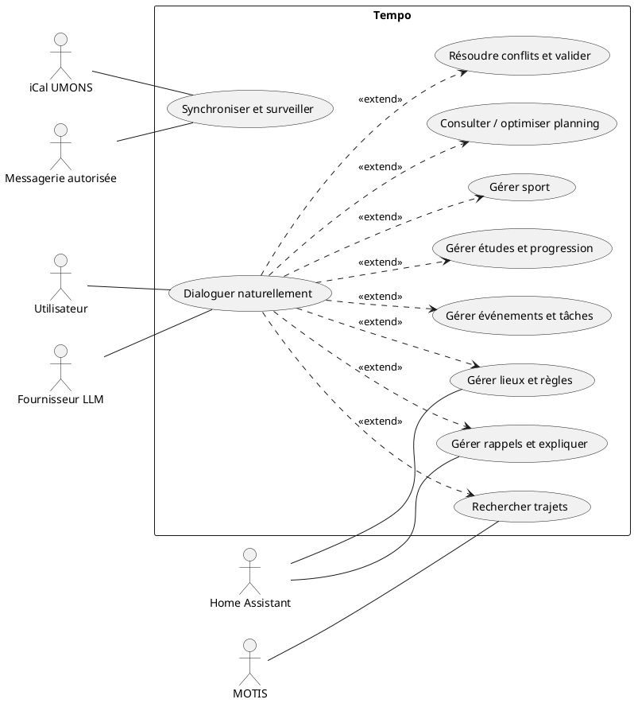
Les liens conversationnels indiquent les capacités mobilisables selon la demande, pas des étapes obligatoires.

## 2. Architecture logique

### D02 — Composants et dépendances

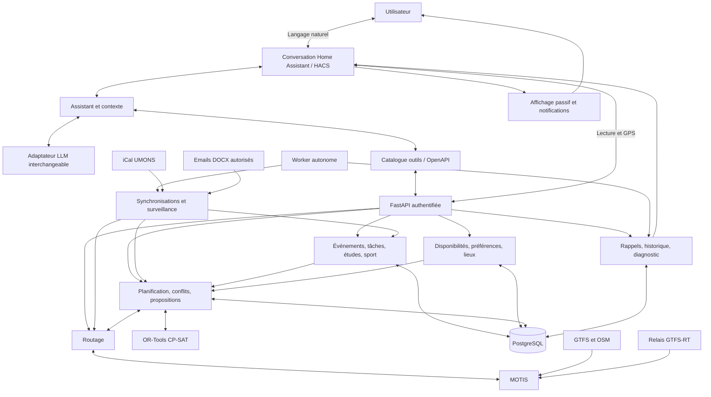

Backend monolithique modulaire, worker séparé si nécessaire. PostgreSQL est la source de vérité métier ; Home Assistant n'est pas une seconde base de planning. Les sources importées restent autorités sur leurs propres événements. MOTIS calcule les itinéraires ; OR-Tools résout les contraintes ; Tempo orchestre. Ne pas dupliquer les moteurs ni ajouter une passerelle IA/Code Mode obligatoire sans besoin démontré.

## 3. Conversation et contrat API

### D03 — Séquence d'une demande composée

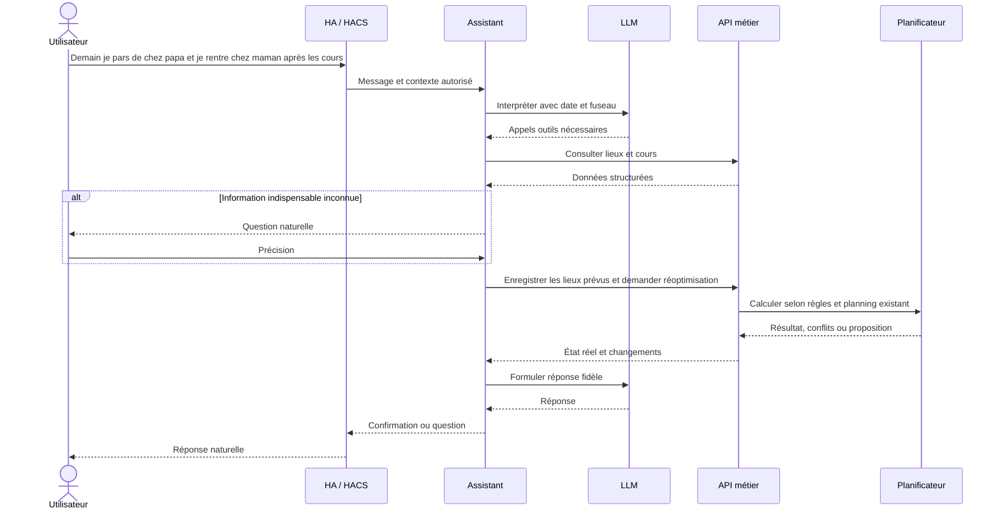

| Domaine | Capacités à exposer à l'IA |
|---|---|
| Événements | Lister/rechercher, lire, créer, modifier, annuler/supprimer, déplacer, verrouiller, gérer séries et exceptions |
| Tâches et études | CRUD, matières, volumes, échéances, priorités, fractionnement, séances, progression et correction |
| Sport | Consulter/importer, déplacer entraînement, déclarer réalisation, gérer compétition personnelle |
| Planning | Consulter par période, simuler, optimiser localement/globalement, expliquer, comparer versions |
| Transport | Rechercher selon contraintes, comparer, actualiser, consulter étapes et statut |
| Lieux | CRUD lieux connus, lire GPS, définir/corriger localisation prévue |
| Règles | CRUD disponibilités, préférences, contraintes, exceptions |
| Rappels | CRUD rappels et règles de notification |
| Propositions | Lister, lire, accepter, refuser, demander alternative |
| Sources et diagnostic | État, fraîcheur, actualisation autorisée, conflits, historique, erreurs métier |

OpenAPI et schémas structurés ; catalogue des opérations autorisées, arguments validés, résultats typés. L'IA peut enchaîner les appels, mais ne contourne pas les règles métier. Authentification, autorisation par opération, identifiants stables, contrôle de version et idempotence des mutations. Une demande explicite autorise son périmètre, pas toutes ses conséquences protégées. Pas de SQL, shell, Docker ou secrets accessibles au LLM. Contexte : conversation récente, préférences persistées, données métier récupérées à la demande, date et fuseau Europe/Brussels. Ne pas prétendre qu'une mutation a réussi avant résultat confirmé. Les contenus importés sont des données non fiables, jamais des instructions pour l'agent.

## 4. Modèle métier unifié

### D04 — Classes conceptuelles

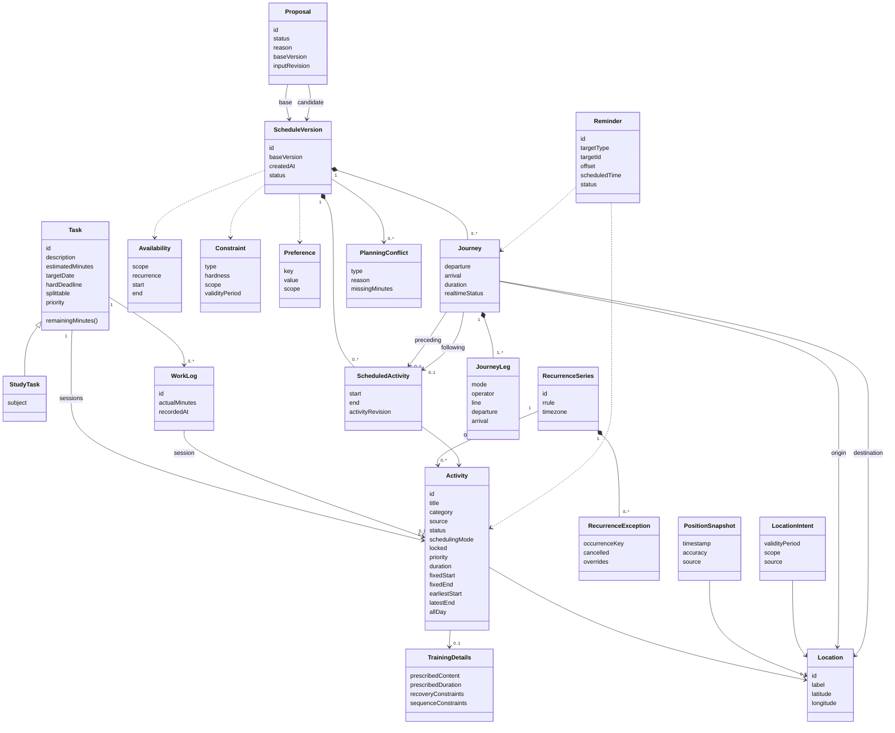

Catégorie (personnel, université, compétition, entraînement, séance de tâche, étude, etc.), flexibilité et verrouillage sont indépendants. Les horaires des activités flexibles appartiennent à la version planifiée ; les horaires imposés appartiennent à la définition de l'activité. Les versions historiques doivent rester interprétables même si une activité est modifiée. Les événements journée entière ne bloquent pas forcément toute la journée : préciser leur caractère occupé ou informatif. Les activités à distance ou sans déplacement n'exigent pas de trajet. Une tâche n'est pas une séance : le volume restant découle des journaux de travail, non du calendrier.

### D05 — Cycle de vie d'une activité

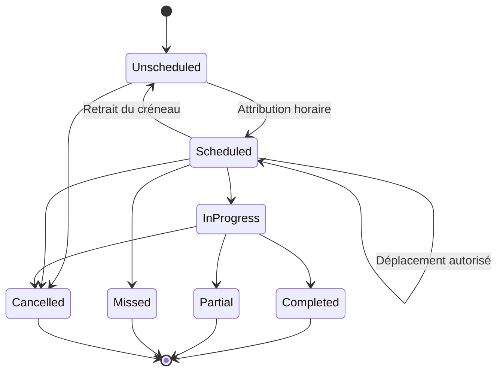

Une séance partielle ou manquée reste dans l'historique ; le reliquat produit de nouvelles séances. Ne pas déduire automatiquement un travail réalisé du simple passage de l'heure. Utiliser RRULE et une bibliothèque existante pour les séries ; gérer une occurrence, les suivantes ou toute la série, exceptions et fuseaux. Générer les occurrences sur un horizon borné. Une suppression doit préserver la cohérence des références et de l'audit.

## 5. Entrées et règles par domaine

### D06 — Synchronisation des sources

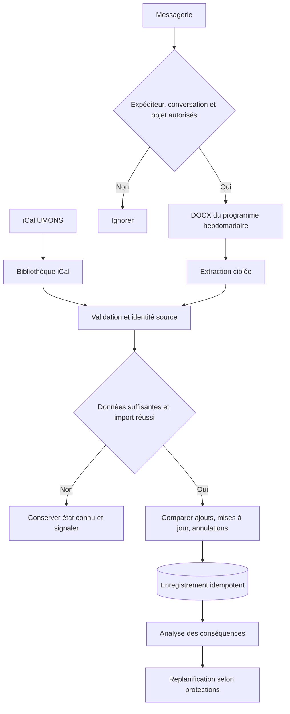

- Université : cours/examens fixes, autorité iCal, identités UID et occurrences, fuseaux et annulations. Ne pas interpréter une panne ou un import partiel comme suppression générale.
- Sport : lire uniquement les messages autorisés du coach, objet `plan` selon contrat existant, tableau DOCX lundi–dimanche. Préserver contenu, durée, ordre et récupération prescrits ; jours et heures flexibles sauf compétitions fixes. Ne pas inventer une durée inconnue. Voir TRAINING_EMAILS.md.
- Études : volume par matière, cible éventuellement lointaine, souple par défaut. Préférer 90 minutes, alternance, pauses, répartition et éviter la même matière immédiatement après son cours ou en blocs successifs. Déclarer/corriger le travail par conversation ; journal idempotent et reliquat recalculé.
- Personnel : rendez-vous imposés fixes ; sorties, tâches et autres activités flexibles selon intention. Durée inconnue : conserver en attente ou demander une précision ; pas de durée arbitraire présentée comme certaine.
- Disponibilités : gérer en conversation les fenêtres générales et par catégorie, récurrences et exceptions datées. Une exception ne supprime pas silencieusement une interdiction stricte. Les sources HA existantes peuvent être conservées si cohérentes avec cette gestion.

## 6. Localisation et transport

### D07 — Résolution de la localisation

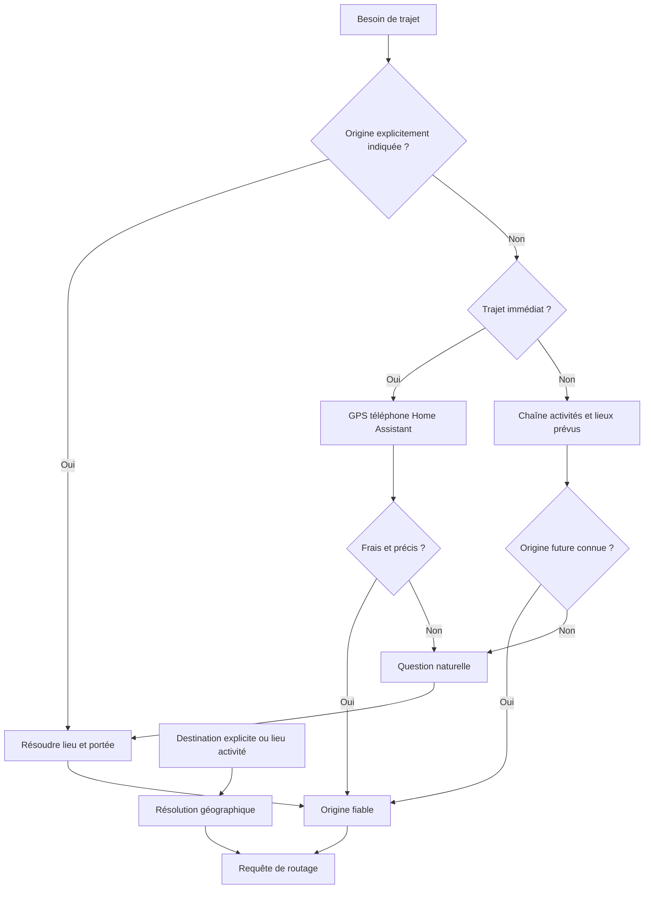

Le GPS réel n'est jamais remplacé par une intention future. Une origine explicite est prioritaire dans le périmètre demandé. Pour une journée future, déterminer la chaîne géographique à partir des événements précédents et intentions datées ; ne pas supposer un domicile. Si le lieu de départ ou de destination manque, demander en conversation ou marquer le trajet non résolu. Pas de menu manuel.

### D08 — Données et moteur de transport

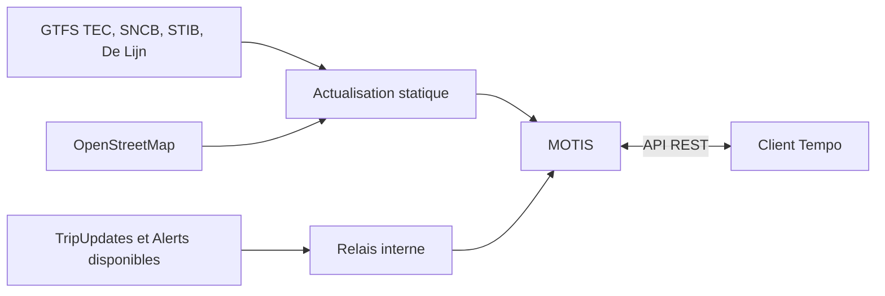

Belgian Mobility Open Data : les documents existants du 23/11/2026 indiquent quatre flux statiques et TripUpdates/Alerts pour TEC, SNCB et De Lijn ; STIB statique uniquement dans ce périmètre. Revalider les flux et le contrat MOTIS avant exploitation. Conserver le relais pour clé, quotas, fraîcheur et correction TEC D021 si toujours nécessaire. Voir TRANSPORT.md. Aucun graphe, calcul de correspondances ou moteur piéton maison.

### D09 — Contrat et séquence de recherche

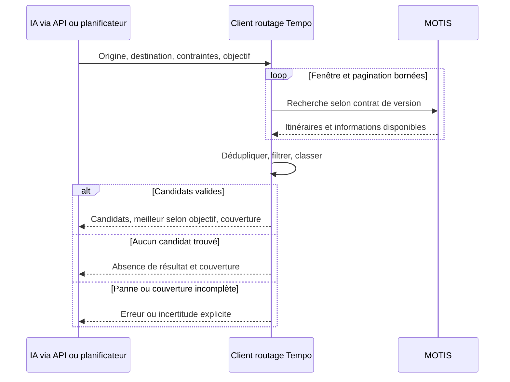

| Contrat | Exigence |
|---|---|
| Entrées | Coordonnées origine/destination, départ minimal facultatif, arrivée maximale facultative (au moins une limite), horizon borné, modes autorisés, objectif, marge applicable. |
| Modes | Arrivée avant ; départ après ; plage avec les deux bornes. |
| Objectifs | Durée porte-à-porte minimale par défaut, arrivée au plus tôt ou départ au plus tard selon demande ; départage déterministe. |
| Sorties | Départ, arrivée, durée, étapes, marche, correspondances, opérateur, ligne, arrêts, état temps réel, fraîcheur, candidats et couverture. |
| Statuts | Résultat, aucun candidat trouvé, recherche incomplète, données indisponibles, erreur technique. |

La durée du trajet est arrivée moins départ ; l'arrivée au plus tôt tient également compte de l'attente avant le départ. Explorer suffisamment la plage via les capacités réelles de MOTIS (pagination, fenêtres, etc.). Ne promettre un optimum que parmi les candidats effectivement explorés. Les marges avant rendez-vous et après activité doivent être intégrées sans double comptage. Le planificateur conserve des alternatives utiles, pas seulement le meilleur trajet isolé. Les trajets nécessaires, y compris retour lorsque destination prévue, sont obligatoires dans le planning. Ne pas inventer de trajet.

## 7. Optimisation et stabilité

### D10 — Activité de planification et replanification

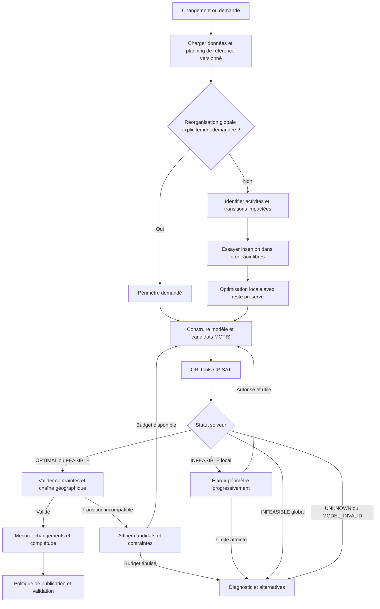

Contraintes dures : absence de chevauchement des occupations, horaires imposés, verrouillages, disponibilités applicables, durées prescrites, échéances strictes, récupération et ordre obligatoires, faisabilité géographique. Ne jamais les relâcher silencieusement. Les événements officiels incompatibles doivent rester visibles comme faits, avec conflit explicite.

Objectifs hiérarchisés :
1. Respecter les contraintes dures ; dans une solution complète, couvrir les engagements et volumes obligatoires.
2. Maximiser la réalisation des activités flexibles demandées selon priorités et échéances, en distinguant reliquat et violation stricte.
3. **Minimiser les changements non demandés** : nombre d'activités déplacées/supprimées, changement de jour, amplitude horaire, modifications de trajets et rappels, pénalité accrue pour activités imminentes.
4. Optimiser les autres préférences : blocs de 90 min, alternance, équilibre, trajets, temps morts.

Utiliser une optimisation lexicographique ou des poids bornés démontrant la priorité des objectifs. Un gain marginal de confort ne justifie pas un déplacement inutile. En mode normal, ne pas déplacer une activité non concernée si une solution équivalente existe sans déplacement. Une annulation libérant du temps ne déclenche pas à elle seule une réorganisation générale. La demande explicite de réorganisation réduit le poids de stabilité uniquement dans le périmètre demandé. Les activités verrouillées ou en cours restent protégées. Conserver les identifiants de séances inchangées.

MOTIS et CP-SAT : fournir des candidats de trajet compatibles avec les fenêtres possibles ; modéliser les transitions et vérifier la chaîne finale. Si une transition est impossible, rechercher d'autres candidats ou ajouter des contraintes valides puis réoptimiser avec budget borné. Ne pas ajouter les trajets après coup sans revalidation. Distinguer une impossibilité démontrée du modèle d'une absence de candidats due à une couverture limitée.

## 8. Absence de solution et alternatives

### D11 — Diagnostic des résultats

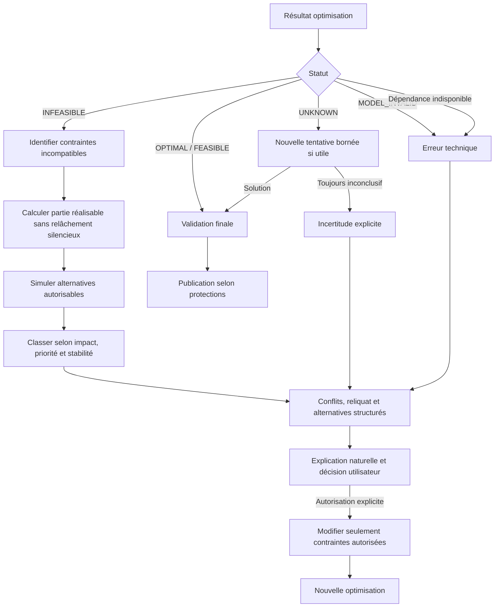

- OPTIMAL : optimum démontré pour le modèle ; FEASIBLE : solution valide sans preuve d'optimalité ; INFEASIBLE : impossibilité pour le modèle ; UNKNOWN : conclusion non démontrée ; MODEL_INVALID : défaut technique. Une panne MOTIS n'est pas une preuve d'impossibilité.
- Identifier les causes à partir des contraintes et données réelles (hypothèses CP-SAT et noyaux incompatibles si utiles ; ne pas promettre un noyau minimal). Causes possibles : manque de temps, engagements fixes en conflit, trajet absent, échéance trop proche, règles incompatibles.
- Pour le planning partiel, autoriser explicitement des activités flexibles non affectées à un créneau et des minutes non planifiées ; conserver le volume restant. Une échéance stricte non satisfaite est signalée comme violation de l'objectif, jamais comme réussite. Les engagements fixes incompatibles ne peuvent pas être effacés pour rendre le modèle faisable ; signaler leur conflit et préserver les parties indépendantes.
- Simuler des alternatives : élargir disponibilités, déplacer activité flexible, fractionner si autorisé, changer trajet/mode autorisé, reporter une échéance, demander modification d'un engagement personnel. Ne proposer comme réalisables que les alternatives effectivement vérifiées. Classer par impact, travail récupéré, priorité et stabilité. Ne pas modifier les sources officielles ni les contraintes dures sans autorité.
- Conserver le dernier planning validé dans l'historique, enregistrer les nouvelles informations officielles et signaler les créneaux devenus invalides. Ne pas présenter l'ancienne version comme encore réalisable si les faits ont changé.

### D12 — Contrat des résultats d'optimisation

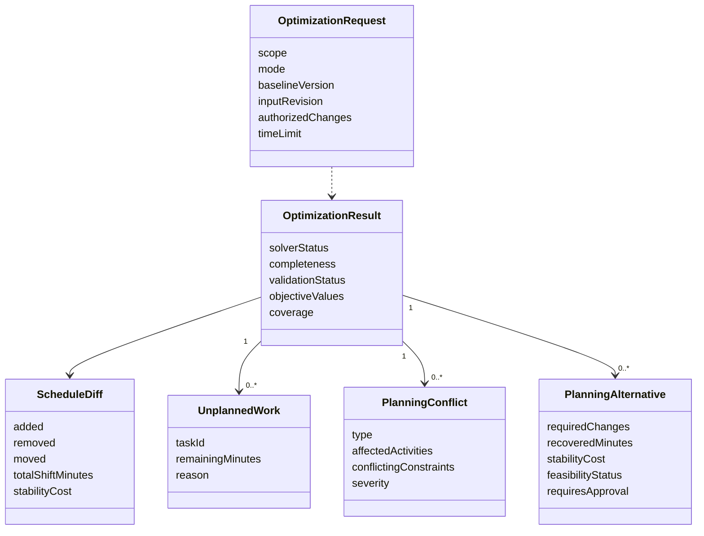

Exemple : « Prévois 15 heures de physique avant vendredi ». Si seulement 10 heures sont réalisables, annoncer les 10 heures placées et les 5 restantes, expliquer pourquoi, proposer des alternatives vérifiées. « Termine plutôt dimanche » autorise le changement de cible et une nouvelle optimisation, sans toucher inutilement aux autres activités.

## 9. Publication, approbations et concurrence

### D13 — Séquence de modification nocturne

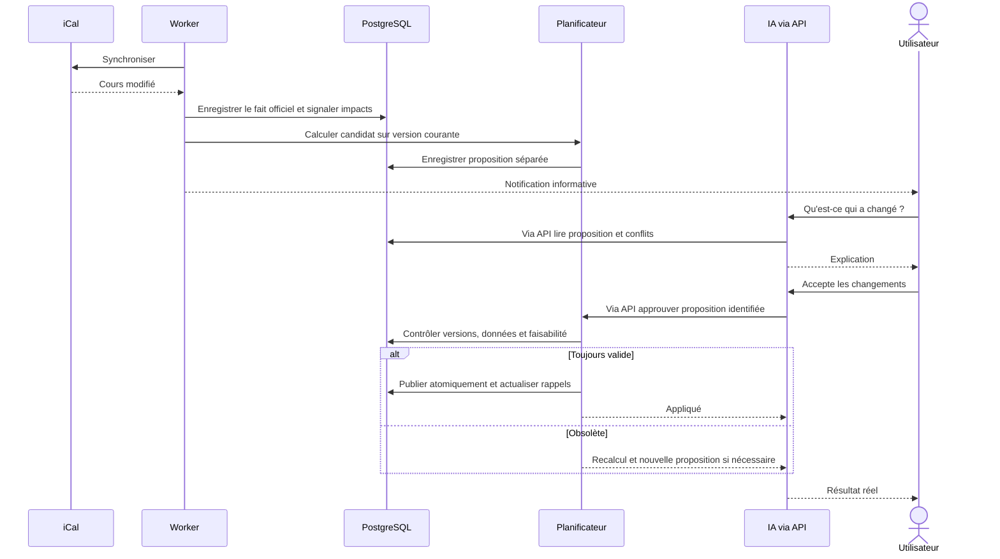

### D14 — États d'une proposition

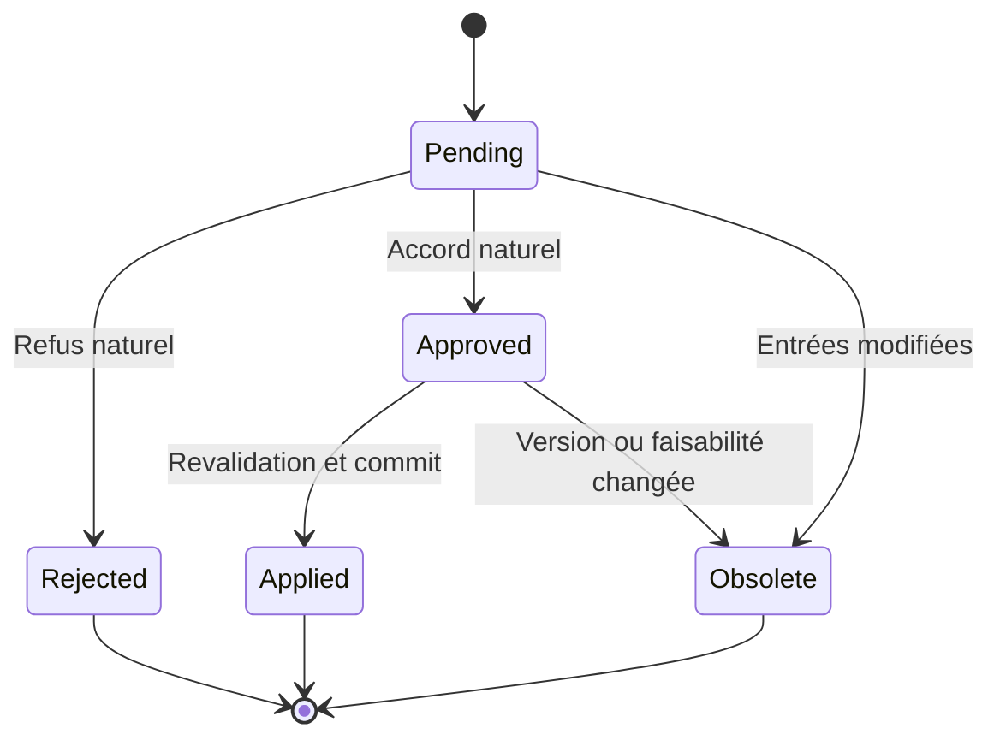

Les modifications ordinaires flexibles et sûres sont automatiques. Une demande explicite autorise les changements personnels demandés ; les effets supplémentaires protégés exigent accord. Lors d'une modification iCal pendant le sommeil, enregistrer immédiatement le cours officiel et attendre validation avant réorganisation du reste. Les propositions sont séparées du planning publié. Refuser préserve les engagements encore réalisables et laisse les conflits explicites. Utiliser transactions, contrôle optimiste de version et clés d'idempotence ; aucun écrasement silencieux par un worker concurrent. Les rappels sont recalculés après publication, pas sur une proposition non acceptée.

## 10. Worker, perturbations et notifications

### D15 — Cycle autonome

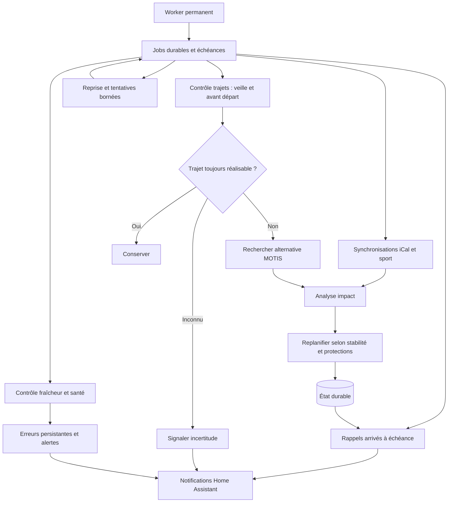

Plusieurs rappels de départ configurables en conversation, rappels d'événements et échéances, alertes de conflits et perturbations. Dédupliquer par identité stable, annuler les rappels obsolètes et reprendre après redémarrage. L'absence de temps réel n'est pas une confirmation de ponctualité. Les automatismes ne nécessitent pas un LLM disponible. Les notifications sont informatives ; toute validation ou modification se fait en langage naturel.

## 11. Déploiement et exigences non fonctionnelles

### D16 — Déploiement cible

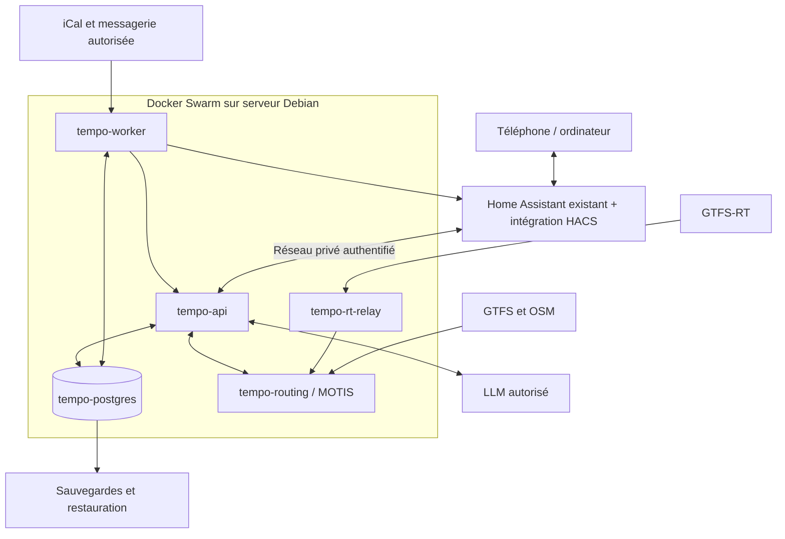

Intégration `tempo-homeassistant` dans son dépôt dédié, `custom_components/tempo` : installation HACS réelle, config flow technique, conversation, calendrier en lecture, capteurs, affichage du travail restant, GPS et notifications. Ne pas développer d'interface métier de mutation parallèle. OR-Tools est une bibliothèque, pas un conteneur obligatoire. Conserver les frontières et technologies existantes lorsqu'elles satisfont le besoin.

Sécurité : réseaux privés, authentification, moindre privilège, secrets hors Git et logs, données personnelles minimisées, accès mail limité, aucune exposition directe de PostgreSQL ou Docker à l'IA. Fiabilité : migrations, transactions, sauvegardes restaurables, health checks, délais et retries bornés, logs structurés expurgés, gestion fuseau et changement d'heure, reprise et idempotence. Performance : horizon de planification glissant, conserver les objectifs lointains, limiter appels MOTIS et solveur sans masquer l'incertitude. Pas de dépendance à Claude Code en production.

## 12. Recette et définition de terminé

| Besoin | Vérification observable minimale |
|---|---|
| B01 | Conversation réelle HA : demande composée, référence contextuelle, clarification, réponse fidèle ; aucune interface métier obligatoire. |
| B02 | Créer/déplacer/annuler rendez-vous, événement journée entière, série et exception, verrouiller puis déverrouiller par conversation. |
| B03 | Créer tâche sans durée, la compléter plus tard, planifier puis déclarer progression partielle. |
| B04 | Import iCal réel, modification/annulation, absence de doublons et panne sans suppression abusive. |
| B05 | Volume de 15 h, séances proches de 90 min, échéance souple/stricte, correction de progression sans double comptage. |
| B06 | DOCX autorisé réel, mise à jour sans doublon, entraînement déplacé, compétition fixe, durée inconnue signalée. |
| B07 | Modifier une règle permanente et une exception datée par conversation, respecter leur portée. |
| B08 | GPS frais, GPS périmé, origine future explicite, lieu inconnu ; ne pas altérer GPS réel. |
| B09 | MOTIS réel : arrivée avant, départ après, plage, retour, alternatives, absence de résultat et panne distinguées. |
| B10 | Planning mixte avec déplacements, aucun chevauchement ni transition impossible. |
| B11 | Ajouter un événement dans un créneau libre sans déplacement ; conflit local résolu avec minimum de changements ; réorganisation globale sur demande. |
| B12 | Tester manque de temps, conflit fixe, trajet impossible, UNKNOWN, MODEL_INVALID et panne ; reliquat préservé, alternatives vérifiées, aucune fausse réussite. |
| B13 | Modification nocturne iCal, acceptation/refus naturels, proposition périmée rejetée, concurrence worker/API sans écrasement. |
| B14 | Deux rappels de départ, déplacement du trajet, annulation anciens rappels, absence de doublons après redémarrage. |
| B15 | Worker autonome avec LLM indisponible, reprise après panne, surveillance réelle. |
| B16 | Explication fondée sur contraintes, changements et résultats, diagnostic consultable. |
| B17 | HACS installé, PostgreSQL réel, migrations, authentification, restauration testée, déploiement et santé vérifiés. |

Exécuter lint, vérifications de types si prévues, tests unitaires, intégration, régression et bout en bout. Les mocks sont utiles mais ne prouvent pas l'intégration réelle. Documenter les preuves, écarts et blocages. Une fonctionnalité ne doit être déclarée prête que si son résultat final est utilisable et cohérent avec le reste du système. Ne pas inventer d'état d'avancement.
